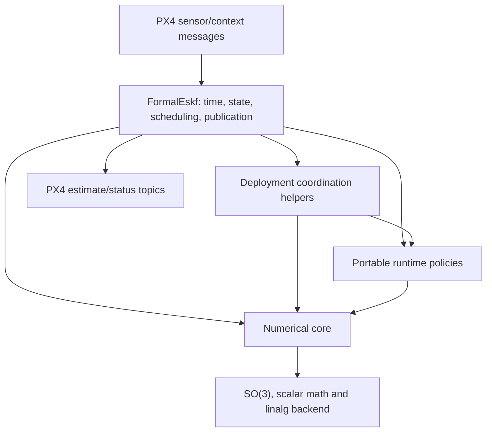

## Summary

The numerical core computes estimator operations; portable runtime components manage sensor and fusion policies; deployment adapters own platform effects. This specification defines those responsibility boundaries and maps the current PX4 implementation to them. Mathematical behavior belongs to the [state conventions](eskf-state-conventions.md) and [requirements](verification-requirements.md).

Verification claims follow the [Formal Verification Strategy](formal-verification-strategy.md); implementation constraints follow the [C++ subset](cpp-portability-and-constraints.md). The source map below describes the existing implementation, not an approved refactor or proof of the full module.

## Architecture

| Layer | Responsibility | Must not own |
|---|---|---|
| Numerical core | Prediction, correction, injection and covariance operations | Clocks, queues, sensor selection or OS effects |
| Portable estimator runtime | Lifecycle, event ordering, fusion decisions and coherent estimates | Device access, OS scheduling or publication |
| PX4 adapter | Message conversion, time sources, serialized access and publication | Undocumented changes to core equations |

Keep the numerical functions independently callable. The runtime is an optional consumer, not a replacement that forces every application into PX4's scheduling model. These are responsibility boundaries, not a prescribed class hierarchy.

Use explicit ownership and isolate external effects in the adapter. Integration must establish serialized estimator access rather than treating a sequential component proof as a concurrency proof.

## Current implementation and ownership

The numerical library supports INS and rotation-only AHRS. The in-tree PX4 module selects INS, double precision and `Px4MatrixBackend`. Portable runtime components are independently usable; there is no single portable runtime object that currently owns and schedules the whole estimator.

| Component | Source | Ownership and use |
|---|---|---|
| Numerical core | [eskf/](../../include/formal_eskf/eskf/), [so3/](../../include/formal_eskf/so3/), [linalg/](../../include/formal_eskf/linalg/), [scalar/](../../include/formal_eskf/scalar/) | Operates on caller-supplied state, covariance and parameters; configuration selects related types and dimensions. No sensor clock or scheduler. |
| Portable sensor policies | [runtime/](../../include/formal_eskf/runtime/) | Components retain their own qualification, sampling and lifecycle history. Callers supply time, measurements and context; fusion operations borrow the estimator state/covariance. |
| Deployment coordination | [ImuPrediction.hpp](../../integrations/px4/module/ImuPrediction.hpp), [HeightAiding.hpp](../../integrations/px4/module/HeightAiding.hpp), [GravityAiding.hpp](../../integrations/px4/module/GravityAiding.hpp), [MagneticAiding.hpp](../../integrations/px4/module/MagneticAiding.hpp) | Bind deployment settings and compose runtime/core operations. Aiding helpers own source-specific history and borrow state/covariance for updates; they do not own uORB publication. |
| PX4 module | [FormalEskf.hpp](../../integrations/px4/module/FormalEskf.hpp), [FormalEskf.cpp](../../integrations/px4/module/FormalEskf.cpp) | Owns the INS state/covariance, runtime/helper instances, geographic origin, sensor subscriptions, sample times, fault state and published reset counters. |
| Host replay | [examples/](../../examples/) | Owns log decoding, replay scheduling and output. Calling the same core does not establish equivalence to the PX4 module's timing or integration. |

Arrows show use, not ownership transfer. The module currently coordinates multiple policies itself; moving that coordination into a portable owner requires the separate architecture review recorded in [ROADMAP.md](../../ROADMAP.md).

### PX4 update sequence

The current `FormalEskf::Run()` path is:

1. Read sensor/context subscriptions and validate a new integrated IMU sample and its timing. Before initialization, qualify startup inputs and establish the initial estimate.
2. After initialization, reject discontinuities or changed IMU identity/calibration. For an admitted short gap, predict with the previous measured rate.
3. Update bias-learning permissions, select process noise and run nominal/covariance prediction for the actual IMU interval.
4. Update magnetic acceleration context, process GNSS velocity/horizontal position, then evaluate vertical IMU health and process height aiding.
5. Process gravity aiding, then magnetic aiding, when their respective conditions permit.
6. Publish estimates while initialized and fault-free. Publish status separately at its scheduled interval, including when no new IMU sample arrives.

`Run()` owns estimator mutation on the PX4 work queue; a mutex serializes it with shell status reads. Numerical failure or a discontinuity can latch a module fault requiring restart. Rejected observations and failed numerical operations have different meanings. Individual checked-operation guarantees do not establish that the entire tick is one failure-atomic transaction.

The [integration guide](../../integrations/px4/README.md#adapter-behavior-and-verification-boundary) owns the pinned target, setup, deployment settings and current limitations. Core/runtime contracts remain in the specifications; the guide's SITL results do not extend their formal proof boundaries.

## Software proof obligations

Use Lean to establish abstract state-transition invariants and ESBMC to check production C++ behavior under explicit assumptions and bounds. Review their correspondence separately; agent review is not a machine-checked proof bridge.

| Area | Property to establish |
|---|---|
| Ownership and memory | Valid lifetimes and accesses under the declared ownership model |
| Lifecycle | Initialization and recovery follow legal transitions |
| State updates | Success is coherent; rejection/failure preserves the estimate |
| Time and context | Fusion respects alignment, identity and coordinate/configuration rules |
| Output | Published estimates have consistent state, time and validity |
| Resources and progress | Operations stay bounded; progress claims state their environment assumptions |

## Review and development gates

| Gate | Required outcome |
|---|---|
| Architecture | Agree on responsibilities, ownership and side effects |
| Behavior | Define operation contracts and lifecycle rules |
| Environment | Identify integration assumptions and supported configurations |
| Proof design | Identify invariants, dependencies and applicable evidence |
| Implementation | Develop components together with their verification |
| Acceptance | Review actual evidence and keep unresolved gaps visible |
