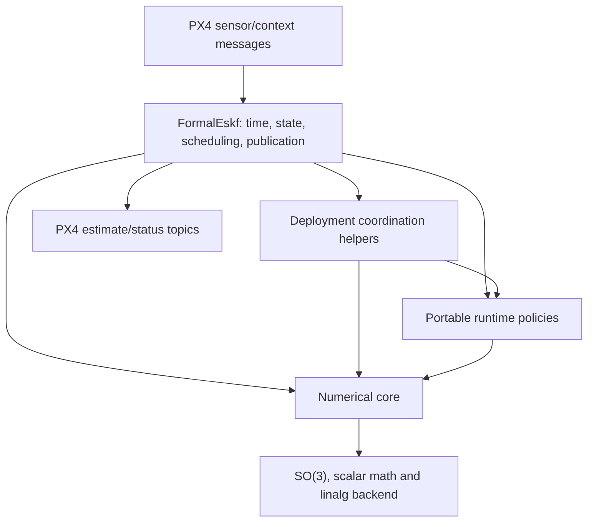

## Summary

The numerical core computes estimator operations; portable runtime components manage sensor and fusion policies; deployment adapters own platform effects. This specification defines those responsibility boundaries and maps the current PX4 implementation to them. Mathematical behavior belongs to the [state conventions](eskf-state-conventions.md) and [requirements](verification-requirements.md).

Verification claims follow the [Formal Verification Strategy](formal-verification-strategy.md); implementation constraints follow the [C++ subset](cpp-portability-and-constraints.md). The source map below describes the existing implementation, not an approved refactor or proof of the full module.

The [PX4 module architecture](px4-module-architecture.md) defines the target
execution, timing, output and real-time contracts for review. The current-source
description below remains the refactor baseline; it does not override that target
or imply that delayed fusion/output prediction are already implemented.

## Architecture

| Layer | Responsibility | Must not own |
|---|---|---|
| Numerical core | Prediction, correction, injection and covariance operations | Clocks, queues, sensor selection or OS effects |
| Portable estimator runtime | Lifecycle, event ordering, fusion decisions and coherent estimates | Device access, OS scheduling or publication |
| PX4 adapter | Message conversion, time sources, serialized access and publication | Undocumented changes to core equations |

Keep the numerical functions independently callable. The runtime is an optional consumer, not a replacement that forces every application into PX4's scheduling model. These are responsibility boundaries, not a prescribed class hierarchy.

Use explicit ownership and isolate external effects in the adapter. Integration must establish serialized estimator access rather than treating a sequential component proof as a concurrency proof.

## Current implementation and ownership

The numerical library supports INS and rotation-only AHRS. The in-tree PX4 module selects INS, double precision and `Px4MatrixBackend`. Portable runtime components are independently usable; there is no single portable runtime object that currently owns and schedules the whole estimator.

| Component | Source | Ownership and use |
|---|---|---|
| Numerical core | [eskf/](../../include/formal_eskf/eskf/), [so3/](../../include/formal_eskf/so3/), [linalg/](../../include/formal_eskf/linalg/), [scalar/](../../include/formal_eskf/scalar/) | Operates on caller-supplied state, covariance and parameters; configuration selects related types and dimensions. No sensor clock or scheduler. |
| Portable sensor policies | [runtime/](../../include/formal_eskf/runtime/) | Components retain their own qualification, sampling and lifecycle history. Callers supply time, measurements and context; fusion operations borrow the estimator state/covariance. |
| Deployment coordination | [ImuPrediction.hpp](../../integrations/px4/module/ImuPrediction.hpp), [HeightAiding.hpp](../../integrations/px4/module/HeightAiding.hpp), [GravityAiding.hpp](../../integrations/px4/module/GravityAiding.hpp), [MagneticAiding.hpp](../../integrations/px4/module/MagneticAiding.hpp) | Bind deployment settings and compose runtime/core operations. Aiding helpers own source-specific history and borrow state/covariance for updates; they do not own uORB publication. |
| PX4 module | [FormalEskf.hpp](../../integrations/px4/module/FormalEskf.hpp), [FormalEskf.cpp](../../integrations/px4/module/FormalEskf.cpp) | Owns the INS state/covariance, runtime/helper instances, geographic origin, sensor subscriptions, sample times, fault state and published reset counters. |
| Host replay | [examples/](../../examples/) | Owns log decoding, replay scheduling and output. Calling the same core does not establish equivalence to the PX4 module's timing or integration. |

Arrows show use, not ownership transfer. The module currently coordinates multiple policies itself; moving that coordination into a portable owner requires the separate architecture review recorded in [ROADMAP.md](../../ROADMAP.md).

### PX4 update sequence

The current `FormalEskf::Run()` path is:

1. Read sensor/context subscriptions and validate a new integrated IMU sample and its timing. Before initialization, qualify startup inputs and establish the initial estimate.
2. After initialization, reject discontinuities or changed IMU identity/calibration. For an admitted short gap, predict with the previous measured rate.
3. Update bias-learning permissions, select process noise and run nominal/covariance prediction for the actual IMU interval.
4. Update magnetic acceleration context, process GNSS velocity/horizontal position, then evaluate vertical IMU health and process height aiding.
5. Process gravity aiding, then magnetic aiding, when their respective conditions permit.
6. Publish estimates while initialized and fault-free. Publish status separately at its scheduled interval, including when no new IMU sample arrives.

`Run()` owns scheduling, subscription updates and status publication under one
mutex shared with shell status reads. `process_imu()` owns sample admission,
timeline consumption, initialization and estimate publication. For an initialized
filter, `predict_and_fuse()` handles continuity, gap holds and the ordered aiding
sequence above. A failed stage prevents later aiding and estimate publication.
After entering this prediction path, the caller stores the admitted sample as
previous-IMU metadata even if prediction or fusion fails; earlier admission,
finite-data and GNSS-quality failures retain the previous metadata.
Numerical failure or a discontinuity can latch a module fault requiring restart. Rejected observations and failed numerical operations have different meanings. Individual checked-operation guarantees do not establish that the entire tick is one failure-atomic transaction.

The [integration guide](../../integrations/px4/README.md#adapter-behavior-and-verification-boundary) owns the pinned target, setup, deployment settings and current limitations. Core/runtime contracts remain in the specifications; the guide's SITL results do not extend their formal proof boundaries.

### Integration invariants and proof boundaries

| Boundary | Owner and invariant | Premise for composition |
|---|---|---|
| Timeline and mutation | The module serializes each tick. Admission failure preserves the horizon; admitted non-finite data consumes the horizon and faults an initialized filter. Watchdog/status scheduling continues without new IMU. | Adapter timestamps, units, identity and work-queue serialization must be established separately from numerical correctness. |
| Prediction and health | Configured noise is selected afresh for each interval. Bias learning uses preceding vertical health; current GNSS velocity and preceding height evidence feed the next health evaluation before height correction. Held rates never become fresh observations. | Sample integration intervals and clipping/context availability are supplied honestly. Module and replay retain their distinct missing-data policies. |
| Source actions and feedback | Each controller owns its qualification/history. Its current action authorizes a call; only actual correction/reset results acknowledge progress. Numerical failure, rejection and deliberate inhibition remain distinct. | The caller uses the same sample/prior and completes feedback before the next update; no fabricated successful fusion or reset. |
| Geographic and magnetic references | Navigation origin, previous GNSS fix, selected magnetic observation reference and optional magnetic-health reference have different lifetimes and purposes. | Source/calibration/reference changes follow their existing reset rules; similar coordinates do not justify merging their history. |
| Publication and recovery | The module owns fault latching and reset counters/deltas. Successful operations may precede a later failure in the same tick; published estimates require initialization and no fault. | Per-operation output preservation is not whole-tick rollback, and native/SITL evidence is not a concurrency or hardware-safety proof. |

The replay keeps CSV cursors, its log-time scheduler and evidence files. Its
`predict_interval()` explicitly receives the prior, configured parameters and
available noise context; prediction statistics describe the executed intervals.
Sharing runtime components does not make replay and module scheduling equivalent.

### Caller differences before shared aiding

The following differences were checked before consolidating runtime headers and
retiring the unused timed IMU qualification policy. File consolidation preserves
both callers; it does not make their integration profiles equivalent.

| Boundary | PX4 module | Replay | Refactor treatment |
|---|---|---|---|
| Gravity sampling and tilt | `GravityAiding::update` evaluates tilt and samples after navigation/height corrections. Separate angle/velocity periods preserve the measured angle integral. | `replay` evaluates tilt and samples on the predicted prior, before navigation corrections; its prepared sample supplies one common period. | Preserve the documented horizons and integration periods. Sharing a controller must not silently move these evaluations. |
| Horizontal aiding | Gravity and magnetic conditions consume current GNSS lifecycle activity. | `ReplayFusionConditions` retains activity for 7 s after an actual horizontal correction/reset. | Preserve caller-supplied meaning; do not infer one from the other in a common helper. |
| Missing IMU metadata | The module validates actual clipping/identity metadata and faults on unsupported discontinuities. | Missing clipping assumes clear only for bias learning; it blocks gravity fusion and invalidates vertical-health history. | Keep input compatibility in the adapter; absence must not become measured health. |
| Magnetic admission and settings | `MagneticAiding` discards arrivals aged 500 ms or more before updating lifecycle receipt, rejects unusable external fields, and binds fixed deployment settings. | Replay selects the newest arrived sample per tick and passes it to the lifecycle without the same admission filter; parameters and field checks can come from replay inputs. | Preserve existing admission/configuration boundaries; sharing lower-level code does not establish equal decisions. |
| Magnetic heading alignment | `MagneticAiding` clears alignment on an unaided stop and explicitly supplies `heading_aligned` to the lifecycle. | Replay clears its local alignment flag on selected source changes, but omits that lifecycle field and therefore supplies its default `true`; it also lacks the unaided-stop alignment transition. | **Known replay wiring gap**, not an approved policy difference. Resolve separately before sharing magnetic coordination. |
| Height sources | `HeightAiding` arbitrates barometer/GNSS and owns their offsets and datum. | Replay uses its GNSS-only vertical lifecycle. | Keep source arbitration and datum ownership distinct; a header merge cannot substitute one controller for the other. |
| Numerical failure | A module fault prevents later aiding/publication and requires restart. | Replay terminates with an error; earlier successful operations remain observable in its evidence. | Preserve each caller's failure boundary; neither provides whole-tick rollback. |

Source boundaries: [module update sequence](../../integrations/px4/module/FormalEskf.cpp),
[gravity coordination](../../integrations/px4/module/GravityAiding.hpp),
[magnetic coordination](../../integrations/px4/module/MagneticAiding.hpp),
[replay sequence](../../examples/replay_ins.cpp), and
[replay conditions](../../examples/replay_conditions.hpp).

The magnetic gap has a concrete consequence: after an unaided data timeout,
the lifecycle requests a reset for a qualified sample when `heading_aligned` is
false, while the default true permits ordinary fusion. Source-change tests can
still pass because the lifecycle separately remembers source-required resets.
This gap predates the file consolidation; passing existing tests does not close
it. Correcting it needs its own behavior change and regression case, not a
compatibility switch that permanently preserves the omission.

These are composition boundaries for the software verification plan. Existing
core proofs remain scoped to their own contracts; runtime/controller and complete
module formal proofs remain pending.

## Software proof obligations

Use Lean to establish abstract state-transition invariants and ESBMC to check production C++ behavior under explicit assumptions and bounds. Review their correspondence separately; agent review is not a machine-checked proof bridge.

| Area | Property to establish |
|---|---|
| Ownership and memory | Valid lifetimes and accesses under the declared ownership model |
| Lifecycle | Initialization and recovery follow legal transitions |
| State updates | Success is coherent; rejection/failure preserves the estimate |
| Time and context | Fusion respects alignment, identity and coordinate/configuration rules |
| Output | Published estimates have consistent state, time and validity |
| Resources and progress | Operations stay bounded; progress claims state their environment assumptions |

## Review and development gates

| Gate | Required outcome |
|---|---|
| Architecture | Agree on responsibilities, ownership and side effects |
| Behavior | Define operation contracts and lifecycle rules |
| Environment | Identify integration assumptions and supported configurations |
| Proof design | Identify invariants, dependencies and applicable evidence |
| Implementation | Develop components together with their verification |
| Acceptance | Review actual evidence and keep unresolved gaps visible |
