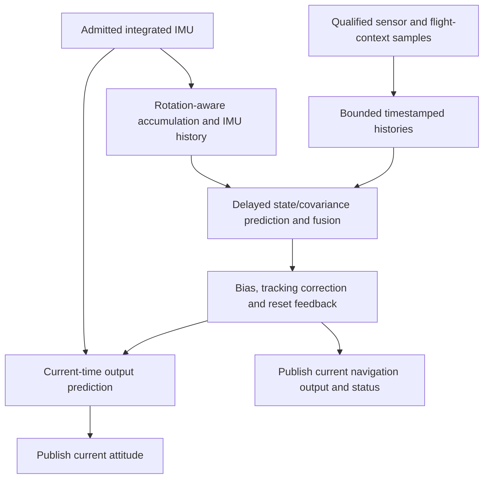

## Summary

Define the target architecture of the single-instance formal-eskf PX4 module.
This is the module design baseline for review: subsequent work must implement
these boundaries and contracts, rather than choose a new architecture in each
refactor. It does not claim that the current SITL module already implements them.

The behavioral reference is **PX4 v1.16.2,
`54f0455ffcd755534539a7cf33a09a20bf71d29d`**. Adopt its single-writer execution,
separate output prediction and delayed fusion, and explicit sensor timing.
Retain our numerical contracts and the [C++ subset](cpp-portability-and-constraints.md);
upstream inheritance, allocation choices and numerical shortcuts are not requirements.

The [architecture boundaries](eskf-software-architecture-and-verification-boundaries.md)
describe the layers and current implementation. This specification owns the
target module behavior. Sensor equations, gates and lifecycle rules remain in
the [verification requirements](verification-requirements.md).

## Scope

The module is one primary INS estimator with one IMU, one GNSS source,
barometric height, magnetic heading aiding and optional gravity aiding. Keep
the existing local Cartesian state, body FRD/navigation NED conventions and
reset semantics. The initial numerical profile remains binary64 with
`Px4MatrixBackend`; another scalar/backend/target requires its own evidence.

Multiple estimator instances, sensor redundancy/selection, additional sensor
models and automatic recovery from numerical faults are outside this baseline.
The numerical library remains independently usable for INS and AHRS; the PX4
module does not impose its execution model on other callers.

## PX4-OWN: ownership and interfaces

| Responsibility | Owner | Boundary |
|---|---|---|
| Module lifecycle and platform access | PX4 adapter | Work queue, uORB, platform clock, parameter binding and publication |
| Estimation session | One estimator owner, executed by that work item | Initialization/alignment, nominal state, covariance, source policies, fusion order and fault state |
| Time alignment | Estimation session | IMU accumulation, observation/context histories and delayed fusion horizon |
| Current-time output | Output predictor within the same session | Its own propagated output state/history, corrected by the main filter; no independent covariance or fusion decisions |
| Numerical operations | Existing ESKF/SO(3)/linalg/scalar core | Caller-supplied values and explicit results; no platform effects |
| Diagnostics | Snapshot produced by the owner | Readers consume a coherent snapshot, not live mutable estimator fields |

There is exactly one writer of estimator and output-predictor state. Aiding
components own their source history, not copies of the full filter. Alignment,
reset bookkeeping and estimator faults belong to the session, not to one sensor.

These are responsibility boundaries, not a demand for one class per row.
Use concrete state and direct calls; do not add a generic sensor framework,
virtual policies, callbacks between numerical stages or forwarding-only facades.
PX4 messages are converted at the adapter boundary. Estimation operations receive
explicit values, time and context and can be exercised without a work queue.

## PX4-EXEC: execution and data flow

Use one IMU-triggered `ScheduledWorkItem` on an estimator work queue. Select
priority and stack for the deployment profile, respecting PX4 sensor/controller
scheduling. A backup timer maintains timeout/status processing when IMU stops;
it is not an independent watchdog for a blocked work item.

The branches execute serially in the same work item. They are different update
rates and time horizons, not additional threads.

For each callback:

1. Handle stop requests and perform bounded input admission. Check IMU sequence,
   integration periods, identity/calibration and clipping before propagation.
2. If initialized and healthy, propagate the output predictor with the admitted
   IMU and publish current attitude. Use feedback from completed filter updates;
   this output does not include the fusion work that follows in this callback.
3. Accumulate the same IMU for the main filter and admit bounded sensor/context
   updates. Run at most one main-filter step when a complete interval is ready
   at the delayed horizon. Otherwise finish without covariance/fusion work.
4. Predict delayed nominal state and covariance, then execute eligible aiding.
   Retain the project's ordered dependencies: GNSS velocity then horizontal
   position, vertical IMU health then height, gravity, then magnetic aiding.
   Each numerical operation uses the latest committed prior. This order is our
   integration contract, not a claim of identical PX4 sensor ordering.
5. Feed successful filter corrections, bias estimates and resets into the output
   predictor. Publish navigation estimates from its current-time state and
   update diagnostics. Navigation publication may be rate-limited separately.

IMU downsampling must compose rotations, account for changing body frames when
accumulating delta velocity, preserve actual angle/velocity integration periods
and accumulate clipping information. It must not discard samples or replace
their measured duration with the requested filter period. The target period is
fixed at startup and realized in whole IMU intervals. PX4's default is 10 ms;
it is not a guarantee of exactly 100 Hz or a mandated tuning value for every target.
The accumulated interval must carry equivalent noise statistics under `E-NOISE`;
reusing a raw per-sample variance after changing the integration period is not
an approved discretization. Preserve the sampling/frame contracts of IMU-derived
gravity observations as well as prediction.

No callback may drain an unbounded backlog or repeatedly catch up until wall
time is reached. A declared capacity/rate violation follows the failure policy.
Without a new IMU, bounded source admission and wall-time expiry/status handling
continue, but the estimator must not invent an IMU interval or advance its horizons.

## PX4-TIME: timestamps and bounded history

Keep these meanings distinct, in one monotonic PX4 time domain:

| Time | Meaning and use |
|---|---|
| Sample time | Physical measurement epoch, with its integration interval where applicable |
| Effective observation time | Sample epoch adjusted once for residual sensor delay and the specified interval reference |
| Latest IMU time | Epoch of the current output state; advances only with admitted IMU intervals |
| Fusion time | Epoch of the main filter state/covariance, behind the latest IMU by the configured history delay |
| Wall time | Scheduling, arrival freshness, output age and detection of stopped inputs |

Each topic binding must name its timestamp field, clock domain, units, sample
point/interval convention and any residual delay correction. Receiver UTC and
publication time must not silently substitute for measurement time. Do not
subtract a latency already compensated by the producer. Validate ordering and
offset arithmetic before unsigned subtraction. Check timestamps against the
arrival clock and declared clock uncertainty; a future observation eligible for
buffering means future relative to the fusion horizon, not arbitrary clock error.

Fix the fusion delay and maximum history capacities at startup. The retained
span must cover the declared sensor latency, arrival jitter and filter-period
quantization. Match IMU, observation and output history by timestamps; equal
ring-buffer indices or capacities alone do not establish alignment.

At each fusion step, consume at most one observation per source: the newest
unconsumed sample no later than the fusion time and within that source's allowed
age window. Retire older superseded samples. Keep future eligible samples pending;
discard duplicates, out-of-order arrivals and expired samples with a reason.
Never reuse a sample as fresh evidence or refresh successful-fusion time after
rejection. This bounded selection follows PX4's newest-eligible observation
policy; the allowed timing error remains explicit in the deployment profile.

Flight/rest context affecting delayed fusion must also be valid for that horizon.
Current arrival health and delayed fusion eligibility are separate facts.
Qualification/lifecycle calculations receive their declared time explicitly;
wall-time input/output expiry must continue even when no IMU arrives.
If qualification happens before buffering, retain the result and epoch with
the observation. Current safety conditions may inhibit fusion explicitly; they
must not silently rewrite the historical context of a buffered measurement.

Histories have fixed maximum capacity and no steady-state resizing. Capacity
must cover the retention span at the maximum admitted rate, including jitter.
If an observation history overflows, retire its oldest pending observation and
record the loss; it is not a successful fusion. If required IMU/output history
is lost, stop valid estimation and require restart. Do not silently move the
fusion horizon to conceal missing history.

Count uORB generation losses separately from timestamp gaps. A permitted short
gap may use the existing bounded held-rate prediction policy; held intervals
must also reach the output/history path and must never become fresh gravity,
motion-health or other sensor observations. Unsupported discontinuity follows
the restart-required policy.

### PX4-TIME-BUFFER: sample storage and selection

`include/formal_eskf/runtime/ring_buffer.hpp` provides the portable
`formal_eskf::runtime::RingBuffer` with the PX4-style history API and fixed backing
storage. `RingBuffer<Sample, Capacity>(length)` reserves `Capacity`
slots inside the object and selects an active length in `1..Capacity`. It is a
single-owner runtime utility with no PX4, clock, scheduler or linalg dependency.
Sample construction/copying must be bounded, allocation-free, non-throwing and
non-blocking, with `std::uint64_t time_us` in the common microsecond time domain.
Default construction, copying and moving the buffer are disabled, as in PX4.

| Operation | Required behavior |
|---|---|
| Constructor, `allocate(length)`, `valid()` | Invalid initial length leaves an invalid empty buffer. `allocate` selects a length within the backing capacity without heap allocation; invalid requests leave everything unchanged, equal length preserves history, changed length resets it. Reconfiguration is startup/restart only. |
| `push(sample)` | Requires a valid buffer and caller-admitted, strictly increasing nonzero timestamps. Return `void`, retaining the newest sample and overwriting the oldest when full, as in PX4. It does not validate source timestamps or report overflow. |
| `get_oldest()`, `get_newest()` | Non-consuming const references; require `entries() > 0`. These replace the former FIFO pop interface so processed IMU/output history can remain available. Saved views must not be used across buffer mutations. |
| `operator`, `get_oldest_index()` | Physical slot access, with `index < get_length()`. The owner may correct payloads while preserving their timestamps and ordering. Traverse retained entries from the oldest index with wraparound; zero-time slots are inactive. |
| `pop_first_older_than(timestamp, output, max_age_us = 100000)` | Return `bool`, writing the newest retained sample at/before the horizon with age strictly below the window. The two-argument pointer call and default 100 ms window match PX4. Output must be outside buffer storage. Retire selected/older entries and preserve future ones. On a miss, expire old entries without changing output; null output returns false without mutation. |
| `get_length()`, `entries()` | Report configured length and active retained count. Count/indices use `std::size_t`, avoiding PX4's 8-bit capacity limit. |
| `get_used_size()`, `get_total_size()` | Report metadata plus active payload bytes, and the complete object size including all backing storage. Unused storage remains reserved; no memory is released on consumption. |
| `reset()` | Clear all backing slots, occupancy and indices while retaining the configured length. It does not allocate. |

The caller checks `valid()` during startup and source timestamps before `push`.
Its last-admitted source timestamp survives complete consumption of the buffer;
an empty history does not permit duplicate or backward-time samples. Clear this
watermark only as part of an explicit source/session restart after resolving its
lifecycle and state-reset policy. A buffer reset alone does not resolve that policy.
Before a full-buffer push, it examines `entries() == get_length()` and the oldest
entry's epoch: overwriting already processed retained history is ordinary
rollover; loss of a pending observation must be recorded, and loss of required
IMU/output history must fault the session. The buffer does not distinguish those
roles. Source admission/loss diagnostics are integration obligations, not checks
already implemented by this standalone component. If separate expiry/supersession
counts are needed, the source owner inspects the retained epochs before selection;
`bool` indicates selection only, never fusion success.

The owner supplies already converted effective observation times and a monotonic
fusion horizon, retains matching flight context/qualification, and handles
source/calibration changes. A source-ordered late arrival older than the preceding
fusion horizon may still be used within the current age window. The buffer does
not subtract latency, read clocks or validate payloads. Age uses ordered
subtraction to avoid unsigned overflow; equality with the age limit is expired.
A zero window expires every entry at/before the horizon. Deployment must choose
an explicit positive useful window; 100 ms is PX4's selection window, not a
sensor latency or fusion-delay setting.

#### Use by each history owner

| Owner | Stored history and permitted operations |
|---|---|
| Delayed IMU prediction | Complete admitted integration intervals, with end timestamps and measured durations. Push once per completed main-filter interval and read the delayed end without consuming history. Observation coalescing must never skip IMU intervals. |
| Sensor/context admission | Effective observation epoch, measurement and the qualification/context that belong to it. Select at most one per source per fusion step. A future sample remains pending; a selected but unqualified sample does not become permission to fuse. A measurement's stored context is not overwritten by current arrival context. |
| Current-time output prediction | State snapshots at the completed IMU-history epochs, alongside the separately propagated current output. Read matching historical state and traverse retained entries to apply tracking corrections or state-reset deltas. Modify payloads, retaining timestamps, order and occupancy. |

The session declares its initial filter-state epoch. For the retained-oldest
IMU pattern, warmup requires the configured history length **and** the declared
actual timestamp span before delayed prediction begins. The first interval must
start at the seed epoch; each later interval starts at the last committed state
epoch. Track that epoch independently of the buffer so repeated callbacks cannot
predict the same interval twice. If warmup cannot establish the span before an
unprocessed interval would be overwritten, the profile/input envelope has failed;
do not advance the horizon to conceal that loss. Supported held-rate intervals
follow PX4-TIME; an unsupported discontinuity requires restart.

Output feedback requires a historical output epoch equal to the delayed
IMU/filter epoch. Equal capacities, indices or update counts do not establish
that equality. At startup, do not read empty oldest/newest views or present
default/duplicated samples as measured history. Seed the current state explicitly
and accumulate real timestamped history. Missing matching output history cannot
produce feedback or valid estimation that depends on it.

Distinguish state correction from history invalidation: payload corrections keep
epochs and apply coherently to current and retained output states; session/history
invalidation uses `reset()` and resets the associated cursors/readiness together.
Do not clear slots by assigning `{}` through `operator[]`: that bypasses occupancy
bookkeeping. Iterate only `entries()` retained samples from `get_oldest_index()`
with wraparound by `get_length()`, including during partial warmup.

Per-source capacity and active length come from the declared admitted rate,
retention span, jitter and filter-period quantization. Budget the full backing
capacity using the actual sample types, even for a shorter active length. Keep
histories as estimator-owned members, not large callback-local temporaries.
Reject unsupported startup configurations; changes to timing/length require
restart and requalification. No final target capacities are selected by this
component contract.

The reference is pinned [PX4 RingBuffer](https://github.com/PX4/PX4-Autopilot/blob/54f0455ffcd755534539a7cf33a09a20bf71d29d/src/modules/ekf2/EKF/RingBuffer.h#L48).
The API uses its operation names and non-consuming history access, but is not a
binary-compatible replacement: capacity is bounded at compile time, lengths/counts
use `std::size_t`, and the optional third selection argument permits an explicit
source age window. Consumed/expired timestamp tags are cleared, so `entries()`
counts active retained entries, unlike PX4's scan of all nonzero physical slots,
which can include superseded data. Expired entries are retired even on a miss;
PX4 may retain them. No PX4 source is vendored.

Push, endpoint/index/count/byte queries take constant work for the selected sample
type. Selection examines at most `Capacity` timestamps and clears at most
`Capacity` tags, copying at most one sample. Reset/changed-length configuration
clear at most `Capacity` samples. Length changes are startup/restart only;
source/history invalidation may reset during a callback, whose budget must include
that bounded clearing cost and the associated owner reset work.
No operation allocates, locks, logs or resizes backing storage. Final source
capacities, timing and target memory/latency budgets remain part of F-04 design.

Native evidence is `tests/test_ring_buffer.cpp`, registered as
`formal_eskf.runtime.ring_buffer`: configuration/failure preservation, non-consuming
history, wrap/overwrite, indexed payload correction, selection/expiry/future
retention, timestamp boundaries and deterministic sequences against a linear-list
model. Caller fixtures exercise IMU warmup/once-only prediction/history loss,
source admission/late arrival/qualification/calibration restart, and output
timestamp matching/history correction/reset through the production buffer API.
Those fixtures demonstrate the usage contracts; they do not implement or verify
the module's admission, delayed filter or output predictor. Package tests check
delivery through the shared headers. This is component regression evidence,
not deployed integration, a formal proof or target WCET.

## PX4-LIFE: initialization, failure and shutdown

Startup validates the complete configuration and prepares storage, subscriptions
and publications. Alignment qualifies the required sensors, initializes the
filter and synchronizes the output predictor/history before valid output begins.
No diagnostic or controller may observe a partially initialized estimate.
Changing numerical, timing, capacity or source-selection configuration requires
stop/restart in this baseline; sensor metadata changes follow their source
contracts rather than silently reconfiguring the estimator.

Sensor rejection, source timeout and estimator failure are distinct:

- Rejection leaves that numerical operation's estimate unchanged and does not
  acknowledge fusion. Other permitted aiding may continue.
- Source timeout updates that source's lifecycle and the affected validity;
  it does not by itself reset the entire estimator.
- Numerical failure, unsupported IMU identity/calibration change or loss of
  required integration history latches an estimator fault. Stop further valid
  estimate publication, report the fault and require an explicit restart.

A callback is not a transaction across all sensors. Earlier successful updates
and an attitude already published before a later failure cannot be rolled back.
That attitude describes its recorded epoch and prior completed feedback; no
later publication may claim the failed fusion succeeded. Fault/age reporting
and downstream timestamp checks must make stale output unusable.

On shutdown, stop accepting callbacks, cancel scheduled work, synchronize with
in-flight work and diagnostic readers, then release resources. No callback or
reader may retain access after the estimator is destroyed.

## PX4-OUT: output prediction and publication

Output prediction uses full-rate admitted IMU data and the latest accepted
bias/feedback. Compare output history and the main estimate at the same delayed
epoch to construct tracking corrections; apply them to the current output
without pretending that delayed state was measured at the current time.
Use the PX4 output-observer structure with our quaternion/frame conventions and
numerical contracts. Track attitude, velocity and position tracking error.

Successful filter resets must update affected output history/current state and
publication bookkeeping coherently before the next affected output. Reset
counters advance once per actual reset; reported deltas describe the output
change seen by consumers. Ordinary tracking corrections are not reset events.

Publish sample epoch separately from publication time. Document the horizon of
each covariance/uncertainty field; delayed covariance must not be presented as
a newly propagated current-time covariance. Alignment, active aiding, freshness,
dead reckoning and numerical health must remain separate validity inputs.
Topic mappings retain the existing sensor/reset requirements and PX4 meanings.
Advertisement/publication failure must be observable and cannot count as
successful delivery. Ordinary absence of subscribers is not a delivery failure.

## PX4-RT: real-time constraints

The estimator path must have bounded work and storage. It must not wait for shell
diagnostics, perform blocking console/file/network I/O, sleep, busy-wait, resize
containers or allocate dynamically during normal operation. No C++ exception
may propagate through module execution, including dependency failure paths.
Build flags alone do not establish this contract.

Diagnostic readers consume a fixed-size snapshot. Snapshot exchange must avoid
data races and have a bounded writer cost; an unavailable diagnostic exchange
may skip a snapshot, never an estimator update. Formatting and printing happen
outside estimator synchronization. Snapshots carry their epoch/sequence so a
skipped update is visible as stale diagnostics. This is deliberately stronger
than copying PX4's direct diagnostic reads or holding a filter-wide mutex through
printing.

Startup allocation is permitted with explicit failure handling. Audit platform
dependencies too: uORB `advertise()` alone does not guarantee that first-publish
storage exists. Complete required first-use preparation before normal operation,
without publishing fabricated valid estimates. Use bounded platform primitives
where needed and account for their locking and callback costs. Do not replace
missing allocation/error handling with `noexcept` annotations.

Large numerical temporaries require a compiler stack report and full call-chain
analysis or explicit per-instance workspace. Never introduce shared global
scratch storage. The current 60 KiB SITL reservation is not a target budget or a
stack bound for ARM/STM32.

Each deployable profile records the values below. Validate parameter domains and
cross-constraints at startup; establish execution bounds through target evidence,
not configuration checks inside every estimator update.

| Profile data | Required relationship |
|---|---|
| Supported IMU arrival rate, integration limits and gap tolerance | Define the input envelope; nominal frequency alone is insufficient |
| Main-filter period, fusion delay, per-source delay/age/rate limits | Preserve measured integration periods and keep accepted samples within the history span |
| History capacities and memory/stack limits | Cover the admitted rates, retention and deepest supported call path without resizing |
| Queue priority, attitude/output-age limits and cycle deadline | Account for scheduler interference, synchronization, computation and publication |
| Scalar/backend, algorithm switches, numerical and source parameters | Identify one reproducible configuration with validated units/domains |

The attitude response budget includes scheduling wait, fast propagation and
publication. The complete callback budget includes any main-filter step, all
eligible aiding, feedback and diagnostics. Both must fit their declared deadlines;
the cycle deadline must fit the supported minimum IMU inter-arrival interval.
Measure the simultaneous-aiding, reset, outage and fault paths, not only the
average prediction tick. The same work queue cannot preempt its own slow phase.

Retain wall-clock response/CPU measurements, missed messages/deadlines, maximum
output age, stack high-water and allocation/synchronization observations for
the declared target and load. A measured maximum is an observed bound, not an
analytical WCET proof. Lockstep simulation time and percentile statistics alone
do not establish hard-real-time acceptance.

## PX4-VERIFY: acceptance and change control

| Contract | Required acceptance evidence |
|---|---|
| Ownership and lifecycle | Production-path tests for initialization, stop, failure, concurrent diagnostics and lifetime safety |
| Timing and execution | Deterministic timestamped tests for rate conversion, delay/jitter, selection, duplicates, overflow, missing IMU and context alignment |
| Output and resets | Independent propagation/tracking cases; coherent sample times, reset deltas/counters, validity and uncertainty horizons |
| Real-time deployment | Target build/dependency inspection and resource/deadline evidence under the declared worst-load scenarios |
| Numerical composition | Existing core requirements plus affected runtime/module obligations, linked to the actual production paths |

Use these stable `PX4-*` design clauses when recording implementation and review
evidence. They are not additional passing rows in the current agent-review map.
Map each implemented scope to its requirements, source/configuration and retained
test/proof results before claiming completion. Lean/ESBMC component results do
not prove PX4 scheduling, dependency behavior or target WCET. The
[traceability criteria](formal-verification-traceability-and-review-criteria.md)
continue to govern evidence and certification-related claims.

The current immediate-fusion SITL module is the behavior baseline for A-01
refactors, not an alternative definition of this target. Preserve its behavior
in refactor-only changes. Downsampling, delayed fusion and output prediction
are explicit F-04 behavior changes and require new expected-result evidence;
moving publication earlier is not a behavior-preserving cleanup. F-07.2 owns
target resource acceptance. These remain the existing work groups, not a new
task list or a claim that pending functionality is implemented.

Changes to this architecture require a reviewed specification change and impact
assessment for affected contracts/evidence. Keep implementation status in
[FEATURE_TODO.md](../../FEATURE_TODO.md) and [ROADMAP.md](../../ROADMAP.md), not
as a second changing backlog here.

## PX4 references

All source links use the pinned revision above:

- [EKF2 update and publication order](https://github.com/PX4/PX4-Autopilot/blob/54f0455ffcd755534539a7cf33a09a20bf71d29d/src/modules/ekf2/EKF2.cpp#L728),
  [estimator input/history](https://github.com/PX4/PX4-Autopilot/blob/54f0455ffcd755534539a7cf33a09a20bf71d29d/src/modules/ekf2/EKF/estimator_interface.cpp#L79)
  and [main-filter update](https://github.com/PX4/PX4-Autopilot/blob/54f0455ffcd755534539a7cf33a09a20bf71d29d/src/modules/ekf2/EKF/ekf.cpp#L138).
- [IMU accumulation](https://github.com/PX4/PX4-Autopilot/blob/54f0455ffcd755534539a7cf33a09a20bf71d29d/src/modules/ekf2/EKF/imu_down_sampler/imu_down_sampler.cpp#L13),
  [observation selection](https://github.com/PX4/PX4-Autopilot/blob/54f0455ffcd755534539a7cf33a09a20bf71d29d/src/modules/ekf2/EKF/RingBuffer.h#L120)
  and [output predictor](https://github.com/PX4/PX4-Autopilot/blob/54f0455ffcd755534539a7cf33a09a20bf71d29d/src/modules/ekf2/EKF/output_predictor/output_predictor.cpp#L175).
- [Work-queue configurations](https://github.com/PX4/PX4-Autopilot/blob/54f0455ffcd755534539a7cf33a09a20bf71d29d/platforms/common/include/px4_platform_common/px4_work_queue/WorkQueueManager.hpp#L67),
  [prediction-period parameter](https://github.com/PX4/PX4-Autopilot/blob/54f0455ffcd755534539a7cf33a09a20bf71d29d/src/modules/ekf2/module.yaml#L15)
  and [first-publication allocation](https://github.com/PX4/PX4-Autopilot/blob/54f0455ffcd755534539a7cf33a09a20bf71d29d/platforms/common/uORB/uORBDeviceNode.cpp#L140).
