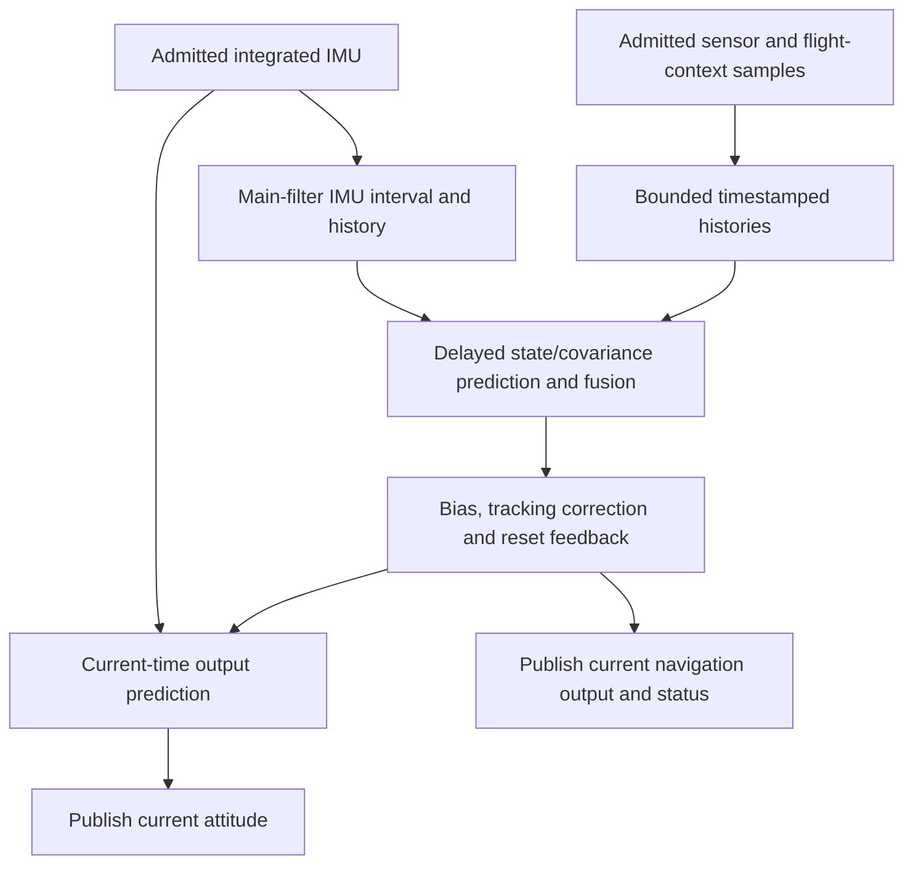

# PX4-EXEC: execution and data flow

**ID:** `PX4-EXEC`

**Applies to:** Single-instance PX4 INS module; linked deployment profile bounds apply.

## Basis

[PX4 module architecture](../../../architecture/px4-module.md) identifies the pinned reference, project adaptations and scope.

## Required behavior

Use one IMU-triggered `ScheduledWorkItem` on an estimator work queue. Select
priority and stack for the deployment profile, respecting PX4 sensor/controller
scheduling. A backup timer maintains timeout/status processing when IMU stops;
it is not an independent watchdog for a blocked work item.

The branches execute serially in the same work item at different time horizons.
Their update rates may be equal; a longer main-filter interval requires the
downsampling contract below. No additional estimator thread is introduced.

For each callback:

1. Handle stop requests and perform bounded input admission. Check IMU sequence,
   integration periods, identity/calibration and clipping before propagation.
2. If initialized and healthy, propagate the output predictor with the admitted
   IMU and publish current attitude. Use feedback from completed filter updates;
   this output does not include the fusion work that follows in this callback.
3. Prepare the same IMU interval for the main filter and admit bounded sensor
   and context updates. Run at most one main-filter step when a complete interval
   is ready at the delayed horizon. Otherwise finish without covariance/fusion
   work.
4. Predict delayed nominal state and covariance, then execute eligible aiding.
   Retain the project's ordered dependencies: GNSS velocity then horizontal
   position, vertical IMU health then height, gravity, then magnetic aiding.
   Each numerical operation uses the latest committed prior. This order is our
   integration contract, not a claim of identical PX4 sensor ordering.
5. Feed successful filter corrections, bias estimates and resets into the output
   predictor. Publish navigation estimates from its current-time state and
   update diagnostics. Navigation publication may be rate-limited separately.

When selected by the profile, IMU downsampling must compose rotations, account
for changing body frames when accumulating delta velocity, preserve actual
angle/velocity integration periods and accumulate clipping information. It must
not discard samples or replace their measured duration with the requested filter
period. The target period is
fixed at startup and realized in whole IMU intervals. PX4's default is 10 ms;
it is not a guarantee of exactly 100 Hz or a mandated tuning value for every target.
The accumulated interval must carry equivalent noise statistics under `E-NOISE`;
reusing a raw per-sample variance after changing the integration period is not
an approved discretization. Preserve the sampling/frame contracts of IMU-derived
gravity observations as well as prediction.

No callback may drain an unbounded backlog or repeatedly catch up until wall
time is reached. A declared capacity/rate violation follows the failure policy.
Without a new IMU, bounded source admission and wall-time expiry/status handling
continue, but the estimator must not invent an IMU interval or advance its horizons.
