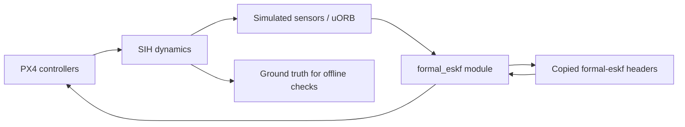

# PX4 SITL integration

This directory owns the PX4 wrapper, board configuration, installation tools and flight tests. The numerical core remains in `include/formal_eskf/`. Installing copies both the wrapper and core headers into PX4; the PX4 build does not reference the original formal-eskf checkout.

The supported target is **PX4 v1.16.2**, commit `54f0455ffcd755534539a7cf33a09a20bf71d29d`, on Linux with GCC 11 or newer and C++20. The dedicated `px4_sitl_formal_eskf` board replaces EKF2 with a single-instance formal-eskf INS using the PX4 matrix backend and double precision.

## Source ownership

| Source in formal-eskf | Installed location in PX4 | Purpose |
| --- | --- | --- |
| `integrations/px4/module/` | `src/modules/formal_eskf/` | uORB adapter, module build, Kconfig and parameter |
| `include/formal_eskf/` | `src/modules/formal_eskf/core/include/formal_eskf/` | Current portable core and runtime headers |
| `LICENSE` | `src/modules/formal_eskf/core/LICENSE` | Core and adapter license |
| `integrations/px4/formal_eskf.px4board` | `boards/px4/sitl/formal_eskf.px4board` | SIH build with EKF2 disabled |
| `integrations/px4/px4-v1.16.2.patch` | Three existing PX4 files | Startup selection, odometry logging and SIH link dependency |

Edit the source in formal-eskf, run the installer again, and rebuild PX4. Changes in formal-eskf do not automatically change an already installed package. PX4 receives regular copied files, with no symlinks, submodule or `FORMAL_ESKF_ROOT` dependency.

## Setup and build

Run these commands from the formal-eskf repository root. `PX4_ROOT` can be anywhere writable; the sibling path below is only an example.

```bash
PX4_ROOT="$(pwd)/../PX4-Autopilot"
./integrations/px4/setup.sh "$PX4_ROOT"
make -C "$PX4_ROOT" px4_sitl_formal_eskf -j8
```

`setup.sh` clones the pinned revision if the target does not exist, initializes only the required MAVLink, events and compression submodules, and installs the package. An existing PX4 checkout must match the pinned commit. It preserves unrelated edits and stops on conflicting files.

Build dependencies include GCC/G++, CMake, Ninja, Python and PX4's `Tools/setup/requirements.txt` (including `empy<4`). Eigen3 is required for the native test oracle. Install the flight test dependencies with:

```bash
python3 -m pip install -r integrations/px4/requirements.txt
```

For an existing PX4 checkout with dependencies already initialized, installation is offline:

```bash
python3 integrations/px4/install.py --px4 "$PX4_ROOT"
make -C "$PX4_ROOT" px4_sitl_formal_eskf -j8
python3 integrations/px4/install.py --px4 "$PX4_ROOT" --check
```

The installer records source revision, source dirty state, and SHA256 hashes in `src/modules/formal_eskf/package-manifest.json`. `--check` checks the copied files and host patch; it does not establish that the binary has been rebuilt. Each flight records the installed manifest and the tested binary's SHA256.

Installation is repeatable. Previously installed files can be updated only if their contents match the previous manifest or the new package. Conflicting local changes and unknown files in the module cause an error before installation. Reconcile or move those files before retrying. A pre-package POC module has no ownership manifest and must be moved aside before its modified files can be replaced.

## Export a package to another machine

```bash
python3 integrations/px4/install.py --export build/px4-package
```

The new directory contains `overlay/`, `manifest.json`, the small PX4 patch and a standalone `install.py`. Copy that directory to the destination machine, then run:

```bash
python3 /path/to/px4-package/install.py --px4 /path/to/PX4-Autopilot
make -C /path/to/PX4-Autopilot px4_sitl_formal_eskf -j8
```

The destination requires the pinned PX4 checkout and its build dependencies. It does not need the formal-eskf source repository. Exports require a new directory to avoid overwriting an earlier package. The manifest detects accidental changes to exported payload files and the host patch.

## Automatic flight

Run from the formal-eskf repository root in a system terminal:

```bash
PX4_ROOT="$(pwd)/../PX4-Autopilot"
RUN_DIR="build/sitl-$(date +%Y%m%d-%H%M%S)"
python3 integrations/px4/sitl_flight.py \
  --px4 "$PX4_ROOT" --output "$RUN_DIR" --check-faults
MPLCONFIGDIR=/tmp/formal-eskf-mpl \
  python3 integrations/px4/analyze_flight.py "$RUN_DIR"
xdg-open "$RUN_DIR/flight.png"
```

The test starts PX4 SIH, uses normal arming, takes off to 5 m, hovers, flies an 8 x 8 m square with a 45-degree heading change, returns, lands and waits for automatic disarming. It then checks invalid GNSS, GNSS timeout and magnetometer timeout, including the 7 s horizontal grace/stop interval and reset counters on recovery. Magnetic checks distinguish outages with and without horizontal aiding, and verify alignment, fusion flags and heading reset notifications across three uORB topics. Omit `--check-faults` for flight only. Each run needs a fresh output directory and takes a few minutes. Instance 1 uses localhost UDP 14541; `--instance` selects another instance from 1 through 9.

The script sends MAVLink commands without the force-arm flag. `COM_RC_IN_MODE=4` configures operation without manual stick input; estimator and sensor arming checks remain enabled. Sensor failure checks run after landing and wait for simulation time to advance, with a bounded wall-clock timeout. The script shuts down the PX4 instance it started.

On a host running other builds or verification tools, PX4 boot can exceed the default 60-second startup deadline. Use `--startup-timeout 180` to allow longer startup; the selected deadline is recorded in `provenance.json`. Flight tracking, estimator validity and offline acceptance thresholds remain the same.

Artifacts include `flight.json`, `faults.json`, `provenance.json`, `px4.log` and the original ULog under `rootfs/log/`. The independent analyzer produces `analysis.json` and `flight.png`, comparing estimates against SIH ground truth. It checks finite states and published covariance diagonals, tracking, attitude error, estimate validity, failsafes, automatic landing/disarming and logging dropouts. Both commands must succeed for full acceptance.

## Interactive flight

```bash
PX4_PARAM_FESKF_EN=1 \
PX4_PARAM_SENS_IMU_MODE=1 \
PX4_PARAM_COM_RC_IN_MODE=4 \
make -C "$PX4_ROOT" px4_sitl_formal_eskf sihsim_quadx
```

Wait for `Ready for takeoff!`, then enter these commands at the `pxh>` prompt:

```text
formal_eskf status
param set MIS_TAKEOFF_ALT 5
commander takeoff
listener vehicle_local_position
listener vehicle_attitude
simulator_sih status
```

When ready to land, enter `commander land`. Wait for `Disarmed by landing` before entering `shutdown`.

## Where the dynamics run

SIH's forces, torques and equations of motion are compiled into the same `build/px4_sitl_formal_eskf/bin/px4` executable. `simulator_sih`, simulated sensors, the estimator and controllers run as tasks in that process and communicate through uORB. The test uses a 4 ms dynamics step (250 Hz) and lockstep simulation time. SIH has no built-in 3D window; the analyzer supplies the flight plot.

The external Python script supplies MAVLink commands and checks results. The dynamics execute inside PX4.



## Adapter behavior and verification boundary

- Uses integrated IMU instance 0 in FRD coordinates and `timestamp_sample`. A single work-queue writer owns the filter, with mutex-serialized shell diagnostics.
- Initializes tilt and gyro bias from stationary IMU samples; magnetometer and the selected geographic/stored/zero declination initialize yaw. No EKF2 or ground-truth subscriptions enter the estimator.
- Qualifies GNSS with the portable quality monitor before startup and fusion. Uses independent velocity, horizontal-position and height gates. Future samples wait; stale/invalid samples cannot refresh health. Velocity and horizontal position have the portable lifecycle and checked resets; each successful reset publishes its deltas/counters. Relative barometer altitude and magnetic measurements remain separate aiding paths.
- Connects magnetic field checks, heading consistency, lifecycle, gated correction and real heading/covariance resets through `module/MagneticAiding.hpp`. The module supplies sensor identity, calibrated FRD samples and current aiding/flight conditions; the helper owns magnetic history, not the estimator state or platform effects. It uses the fixed PX4 v1.16.2 defaults for noise (5 microtesla), gate (3 sigma), strength tolerance (20 microtesla), health (>1 s), no-data stop (1 s) and unsuccessful-fusion timeout (>7 s). These are not live EKF2 parameter bindings.
- Publishes NED position/velocity, scalar-first body-to-NED quaternions, covariance diagonals, biases and estimator status. Horizontal aiding uses actual fusion/reset progress: report dead reckoning after 1 s, withdraw horizontal validity after 5 s, and stop GNSS sessions after 7 s of missing data or sustained poor quality. Height and magnetometer retain the adapter's 1 s freshness policy.
- Holds the previous IMU rate for small missing intervals; discontinuities beyond 50 ms and IMU identity/calibration changes latch a fault. Numerical failures also latch a fault. Restart is required for recovery.
- Reserves a 60 KiB work-queue stack. The module disables fast-math, FMA contraction, exceptions and RTTI. Lockstep virtual-time performance counters do not measure wall-clock CPU cost.

This is a single-sensor SITL POC with stationary startup and simulated sensor noise. It has no receiver-delay compensation, output predictor, redundant sensors, multi-source height reset arbitration, or wind, terrain, barometer-bias and magnetic-bias states. Magnetic fusion retains a three-component observation with `ESKF_MAG_TILT=1`; it reports heading aiding, not 3D magnetic-state estimation. AUTO/3D switching and terrain-based in-flight realignment remain unconnected. See [the magnetic integration contract](../../docs/spec/verification-requirements.md#px4-module-magnetic-aiding). Heading variance approximates yaw variance with the local attitude-error z component for the tested low-tilt flight. Sensor failure checks cover flag withdrawal and recovery on the ground, not continued flight through sensor failures.

### Geographic magnetic reference

The module queries PX4's host WMM at startup and then at intervals greater than
10 s while its own horizontal position is valid. It expresses each model in the
fixed origin NED and adopts changes greater than 1 degree or 1 microtesla.
Unavailable lookups retain the last valid model; without one, strength checks
use the broad fallback range. `formal_eskf status` reports lookup count, model
and heading revisions, selected source and unavailable attempts.

| Startup parameter | Default | Meaning |
| --- | --- | --- |
| `FESKF_DECL_TYPE` | 3 | Bit 0: geographic heading when available; bit 1: permit stored declination fallback |
| `FESKF_MAG_DECL` | 0° | Stored east-positive declination, -180° to 180° |

Mask 0 selects magnetic north; 1 selects geographic or zero; 2 selects stored
or zero; 3 selects geographic, then stored, then zero. Restart the module after
changing settings. WMM still supplies independent health checks when geographic
heading is disabled; its updates cannot rewrite the seed-based heading reference
in that mode. Parameters use `FESKF_` because this board excludes EKF2.
There is no learned-field branch or automatic declination saving.
See [the reference contract](../../docs/spec/verification-requirements.md#px4-module-geographic-magnetic-reference).

The wrapper is outside the portable numerical core and its existing Lean/ESBMC claims. Magnetic integration is linked in the requirement/traceability map with its formal evidence still pending; no proof of PX4, concurrency, total stack use or hardware flight is asserted. Native tests and closed-loop SITL are separate empirical evidence.

The host patch selects the estimator at boot, starts the lockstep logger from IMU updates during alignment, logs odometry variances and adds SIH's direct `lat_lon_alt` dependency. The reduced board can print missing optional DDS, GPS-driver, camera and VTOL command/parameter messages from the shared startup script.

## Developer checks

```bash
./scripts/format_cpp.sh --check
python3 integrations/px4/test_package.py --px4 "$PX4_ROOT"
./integrations/px4/test_core.sh "$PX4_ROOT"
```

Package checks exercise a clean pinned PX4 fixture, standalone export/install, repeat installation, update handling, conflict preservation, revision rejection and exclusion of editor scratch files. Core checks use the existing native suite with the PX4 matrix backend. Run the flight and analyzer above after rebuilding to validate the complete control loop.

## Local validation: 2026-11-06

Built and flown using the installed current headers and the pinned PX4 host.
Normal arming, takeoff, square trajectory, yaw change, landing and automatic
disarming passed. Ground fault checks distinguish 1 s dead reckoning, 5 s
horizontal validity loss and 7 s session stop; recovery increments position
and velocity reset counters once each.

| Check | Result |
| --- | --- |
| Package installation/export | 8 passed |
| GNSS quality/lifecycle/reset and fusion native suites, PX4 matrix | 4 passed |
| Independent ULog acceptance checks | 18 passed |
| Ground sensor failure/recovery scenarios | 10 passed |
| Position / velocity RMSE against SIH truth | 0.381 m / 0.223 m/s |
| Attitude RMSE / maximum error | 1.434 / 3.915 degrees |
| Valid estimates in flight | 100% |
| Numerical faults / airborne failsafes / ULog dropouts | 0 / 0 / 0 |

Local evidence is in `output/px4-gnss-sitl-final/`: source manifest, binary hash,
flight/fault records, ULog, `analysis.json` and `flight.png`. The earlier
`output/px4-gnss-sitl-run/` failed its fixed 4 s recovery expectation after a
stationary-speed check transient; it is retained and is not counted as a pass.
The test now waits for actual quality recovery with a bounded additional 20 s
window, checking that resets do not occur before recovery. Quality thresholds
and health timing were not relaxed.

## Magnetic integration validation: 2026-11-11

The pinned host build, normal flight and independent ULog analysis passed.
The 14 ground scenarios include magnetic outages with/without GNSS aiding,
loss of unaided yaw alignment and one real heading reset on recovery.
Attitude, local-position and estimator-status reset counters agreed; the
recorded reset was -0.02268 rad. This is a control-flow test, not heading-accuracy
ground truth for a physical compass disturbance.

| Check | Result |
| --- | --- |
| Magnetic native suites, float/double | 5 Eigen + 5 PX4 matrix passed |
| Adapter/lifecycle ASan + UBSan, both backends | 4 passed, leak detection enabled |
| Package installation/export | 8 passed |
| Ground failure/recovery scenarios | 14 passed |
| Independent ULog acceptance checks | 18 passed |
| Position / velocity RMSE against SIH truth | 0.404 m / 0.258 m/s |
| Attitude RMSE / maximum error | 1.643 / 3.555 degrees |
| Valid estimates in flight | 100% |
| Numerical faults / airborne failsafes / ULog dropouts | 0 / 0 / 0 |

Evidence is in `output/px4-mag-sitl-02/`, including the source manifest, binary
hash, ULog, fault records, `analysis.json` and `flight.png`. Native tests also
exercise field rejection, heading inconsistency, calibration/source changes,
stale/future/duplicate samples and reset failure. They do not establish aircraft
behavior under in-flight magnetic disturbances. The wrapper/lifecycle additions
have no new Lean or ESBMC proof in this change.

An additional Cppcheck 2.21 compilation-database scan reported no diagnostics
in the module/core, but 334 in upstream/generated PX4 headers. This is not a
clean whole-PX4 static-analysis result or a substitute for formal evidence.

## Magnetic reference validation: 2026-11-11

Two closed-loop runs exercised geographic heading (mask 3) and stored heading
(mask 2, 3.4056056°, the host model's declination at the SIH origin). Both passed
all 18 ULog acceptance checks and 14 ground failure/recovery scenarios.

| Check | Geographic | Stored |
| --- | --- | --- |
| WMM lookup count, startup to landing | 1 → 10 | 1 → 10 |
| Selected heading source | Geographic | Stored |
| Observation reference revision, startup to landing | 1 → 1 | 1 → 1 |
| Position / velocity RMSE | 0.346 m / 0.259 m/s | 0.404 m / 0.256 m/s |
| Attitude RMSE | 1.519° | 1.649° |

Evidence is in `output/px4-wmm-geographic/` and `output/px4-wmm-saved/`, with
source manifests and binary hashes. The stored run used the final build after
splitting the declination status line to avoid console truncation. These short
flights did not cross model-adoption thresholds. Native tests separately exercise
changed models, real heading reset, health-only rejection without heading reset,
all four source masks with/without WMM, failed lookups and frame conversion.
Three native suites passed on each backend (Eigen/PX4 matrix, float/double);
the four adapter suites also passed ASan/UBSan with leak detection enabled.
The pinned host build, all eight package tests, repository Cppcheck profiles
(unix32/unix64) and formatting checks passed. This change adds no Lean/ESBMC
proof or evidence of long-distance/in-flight disturbance behavior.

## GNSS integration scope

Behavior is checked against the pinned
[GNSS checks](https://github.com/PX4/PX4-Autopilot/blob/54f0455ffcd755534539a7cf33a09a20bf71d29d/src/modules/ekf2/EKF/aid_sources/gnss/gps_checks.cpp)
and [fusion controller](https://github.com/PX4/PX4-Autopilot/blob/54f0455ffcd755534539a7cf33a09a20bf71d29d/src/modules/ekf2/EKF/aid_sources/gnss/gps_control.cpp).
The adapter uses their fixed default quality/noise/gate settings; live EKF2
parameter changes do not configure this module. Quality recovery, reset feedback
and message conventions are specified in
[PX4 GNSS integration](../../docs/spec/verification-requirements.md#px4-gnss-integration).

Barometer also aids height, so the single-source GNSS height lifecycle is not
enabled. Height/bias/reference coordination, emergency yaw, receiver selection,
lever arms, delayed fusion and new runtime-policy integration remain separate
work. GNSS sample-time handling is still immediate and differs from EKF2's
buffered publication-time path. This is not complete EKF2 parity.
