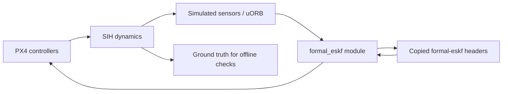

# PX4 SITL integration

This directory owns the PX4 wrapper, board configuration, installation tools and flight tests. The numerical core remains in `include/formal_eskf/`. Installing copies both the wrapper and core headers into PX4; the PX4 build does not reference the original formal-eskf checkout.

Unless stated otherwise, behavior below describes the default profile.

The supported target is **PX4 v1.16.2**, commit `54f0455ffcd755534539a7cf33a09a20bf71d29d`, on Linux with GCC 11 or newer and C++20. The dedicated `px4_sitl_formal_eskf` board replaces EKF2 with a single-instance formal-eskf INS using the PX4 matrix backend and double precision.

## Source ownership

```text
integrations/px4/
  module/        Production C++ and PX4 module build/parameter definitions
  configs/       SITL board configuration
  patches/       Changes required in the pinned PX4 host
  scripts/       Setup, packaging, flight execution and offline analysis
  tests/         Package/core checks and the production-module fixture
  requirements.txt
```

Module `Kconfig`, CMake and parameter declarations stay with the module because
PX4 consumes them there. The installer also packages the module fixture as
an opt-in host fixture; tests are not linked into the flight binary.

| Source in formal-eskf | Installed location in PX4 | Purpose |
| --- | --- | --- |
| `integrations/px4/module/` | `src/modules/formal_eskf/` | uORB adapter, module build, Kconfig and parameter |
| `integrations/px4/tests/ModuleTest.cpp` | `src/modules/formal_eskf/tests/ModuleTest.cpp` | Opt-in production-module fixture |
| `include/formal_eskf/` | `src/modules/formal_eskf/core/include/formal_eskf/` | Current portable core and runtime headers |
| `LICENSE` | `src/modules/formal_eskf/core/LICENSE` | Core and adapter license |
| `integrations/px4/configs/formal_eskf.px4board` | `boards/px4/sitl/formal_eskf.px4board` | SIH build with EKF2 disabled |
| `integrations/px4/patches/px4-v1.16.2.patch` | Three existing PX4 files | Startup selection, odometry logging and SIH link dependency |

Edit the source in formal-eskf, run the installer again, and rebuild PX4. Changes in formal-eskf do not automatically change an already installed package. PX4 receives regular copied files, with no symlinks, submodule or `FORMAL_ESKF_ROOT` dependency.

## Tools

| Entry point | Purpose and effects |
|---|---|
| [scripts/setup.sh](scripts/setup.sh) | Prepare the pinned PX4 checkout and its required submodules, then run the installer. Requires network access when sources are missing. |
| [scripts/install.py](scripts/install.py) | Offline package collection, export, installation or read-only `--check`. Protects local PX4 edits using the previous manifest. |
| [scripts/sitl_flight.py](scripts/sitl_flight.py) | Own one SIH process, command the flight and optional ground faults, then shut it down and retain results. |
| [scripts/analyze_flight.py](scripts/analyze_flight.py) | Independently assess the recorded flight against SIH truth and write metrics/plots. A live flight pass alone is insufficient. |
| [scripts/analyze_frame.py](scripts/analyze_frame.py) | Build the C++ projection probe and compare projection/frame approximations against geographic oracles. No flight commands. |
| [tests/test_package.py](tests/test_package.py) | Exercise installation/export/conflict handling in disposable PX4 fixtures; the supplied checkout is read-only. |
| [tests/test_core.sh](tests/test_core.sh) | Build and run the existing core suite using PX4 matrix and the generated PX4 headers. |
| [tests/test_tools.py](tests/test_tools.py) | Offline checks for acceptance thresholds, fault/reset predicates and command usage. No PX4 process or flight. |

Paths in this table are relative to this directory. Each operational tool has one
entry point; the independent analyzers remain separate from the flight driver.

## Setup and build

Run these commands from the formal-eskf repository root. `PX4_ROOT` can be anywhere writable; the sibling path below is only an example.

```bash
PX4_ROOT="$(pwd)/../PX4-Autopilot"
./integrations/px4/scripts/setup.sh "$PX4_ROOT"
make -C "$PX4_ROOT" px4_sitl_formal_eskf -j2
```

`setup.sh` clones the pinned revision if the target does not exist, initializes only the required MAVLink, events and compression submodules, and installs the package. An existing PX4 checkout must match the pinned commit. It preserves unrelated edits and stops on conflicting files.

Build dependencies include GCC/G++, CMake, Ninja, Python and PX4's `Tools/setup/requirements.txt` (including `empy<4`). Eigen3 is required for the native test oracle. Install the flight test dependencies with:

```bash
python3 -m pip install -r integrations/px4/requirements.txt
```

For an existing PX4 checkout with dependencies already initialized, installation is offline:

```bash
python3 integrations/px4/scripts/install.py --px4 "$PX4_ROOT"
make -C "$PX4_ROOT" px4_sitl_formal_eskf -j2
python3 integrations/px4/scripts/install.py --px4 "$PX4_ROOT" --check
```

The installer records source revision, source dirty state, and SHA256 hashes in `src/modules/formal_eskf/package-manifest.json`. `--check` checks the copied files and host patch; it does not establish that the binary has been rebuilt. Each flight records the installed manifest and the tested binary's SHA256.

Installation is repeatable. Previously installed files can be updated only if their contents match the previous manifest or the new package. Conflicting local changes and unknown files in the module cause an error before installation. Reconcile or move those files before retrying. A pre-package POC module has no ownership manifest and must be moved aside before its modified files can be replaced.

## Configure a PX4 profile

From the formal-eskf repository root:

```bash
make menuconfig
make px4-install PX4_DIR="$PX4_ROOT"
make -C "$PX4_ROOT" px4_sitl_formal_eskf -j2
python3 integrations/px4/scripts/install.py --px4 "$PX4_ROOT" --config .config --check
```

The menu includes exact/approximate prediction and reset, magnetic tilt
protection, plus 64 module settings: WMM, ground-effect/gravity/bias enablement,
GNSS and magnetic checks, lifecycle timeouts, noise, gates, bias limits and output
tracking time constants. Decimal values are validated before packaging. See
[configuration ownership](../../docs/guides/configuration.md#px4-deployment-menu)
for units, defaults and retained constraints.

`make px4-install` uses `.config` (override with `CONFIG_FILE=...`), generates the
module's `DeploymentConfig.hpp`, and records both in the package manifest. It
does not edit the default source header. Rebuild and restart to apply changes;
replay keeps its own profile. Existing `FESKF_*` parameters remain startup-only;
`FESKF_GRAV_EN` cannot enable gravity support excluded by the build.

To export this selected profile, use `make px4-export PACKAGE_DIR=output/px4-package`.
The exported installer requires neither Kconfiglib nor the original checkout.
Direct `install.py` without `--config` continues to package the default profile.

## Export a package to another machine

```bash
python3 integrations/px4/scripts/install.py --export build/px4-package
```

The new directory contains `overlay/`, `manifest.json`, the small PX4 patch and a standalone `install.py`. Copy that directory to the destination machine, then run:

```bash
python3 /path/to/px4-package/install.py --px4 /path/to/PX4-Autopilot
make -C /path/to/PX4-Autopilot px4_sitl_formal_eskf -j2
```

The destination requires the pinned PX4 checkout and its build dependencies. It does not need the formal-eskf source repository. Exports require a new directory to avoid overwriting an earlier package. The manifest detects accidental changes to exported payload files and the host patch.

## Production module tests

After installing the package, enable the host fixture on the pinned SITL target:

```bash
cmake -S "$PX4_ROOT" -B "$PX4_ROOT/build/px4_sitl_formal_eskf" \
  -DCONFIG=px4_sitl_formal_eskf -DFORMAL_ESKF_MODULE_TESTS=ON
cmake --build "$PX4_ROOT/build/px4_sitl_formal_eskf" \
  --target formal_eskf_module_test --parallel 2
"$PX4_ROOT/build/px4_sitl_formal_eskf/formal_eskf_module_test"
```

The fixture executes production `Run()` with real PX4 messages and uORB, using
controlled time and timer dispatch. It checks startup settings, IMU admission,
gap boundaries, sensor sequencing and changes, failure latching, resets,
publication and diagnostic snapshots. The work-queue manager is not started;
unavailable-queue and injected-failure messages are expected. The final scenario
summary and exit code determine success. Scheduler/concurrent-access correctness,
dependency internals and target timing require separate evidence.

The executable optionally takes a trace filename to record state, covariance
and the seven topic payloads for deterministic before/after comparison. The test
target is opt-in and is not linked into the flight binary.

`formal_eskf_module_test --configuration` runs the profile smoke scenario on
stationary sensor data followed by ground effect and a GNSS outage. That fixture
requires initialization within 12 s and a horizontal timeout of at most 10 s;
it is not acceptance evidence for arbitrary menu values or flight conditions.

## Delayed fusion

The live module defaults to a 4 ms interval and at least 200 ms fusion lag
(212 ms at nominal 250 Hz). It retains 54 real intervals before the first delayed
step, while propagating current output separately. Warmup does not publish valid
estimates. Attitude precedes delayed fusion; navigation follows matching feedback.
State resets also transform retained/current output.

| Startup parameter | Default | Unit |
|---|---:|---|
| `FESKF_DT_US` | 4000 | us; only this mode is supported |
| `FESKF_DELAY_MS` | 200 | ms minimum lag |
| `FESKF_GPS_DLY` | 0 | ms residual GNSS delay |
| `FESKF_MAG_DLY` | 0 | ms residual magnetic delay |
| `FESKF_BARO_DLY` | 0 | ms residual barometer delay |

Settings are validated together and require restart. See the
[timing profile](../../docs/spec/profiles/px4-sih-250hz.md) for rate, capacity, offset,
freshness, gap and fault rules. Storage does not resize during operation.

Current attitude/navigation timestamps identify latest IMU output; estimator
status/bias and covariance diagnostics identify delayed main state. Navigation
variance fields use delayed covariance proxies, not a current-time error bound.
`formal_eskf status` reports both horizons, lag, admission losses and phase counters.
SIH's PX4 clock is not wall-clock CPU time or a WCET measurement.

## Sensor positions

Set `FESKF_IMU_POS_X/Y/Z` and `FESKF_GPS_POS_X/Y/Z` to the measured IMU and GNSS
antenna positions, in metres from the vehicle body origin (normally its centre
of gravity), with X forward, Y right and Z down. All default to zero, accept
`[-10, 10]` m per axis and require restart. These are installation measurements,
not parameters to tune for a better-looking trajectory.

GNSS position, height and rotational velocity are compensated to the delayed
IMU state before fusion/reset. Current local/global/odometry position and velocity
are transformed back to the body origin. Heading resets include the resulting
body-point reset deltas. This follows PX4's nominal point-compensation design.

Receiver noise and core covariance equations are unchanged. Installation
uncertainty and preprocessing correlations are not modeled; published variances
remain delayed IMU-state proxies, and local acceleration remains at the IMU.
See [the reference-point contract](../../docs/spec/requirements/integration/px4/sensor-positions.md#r-px4-sensor-positions-sensor-and-output-reference-points)
for frames, signs, timing and evidence limits. Physical nonzero installations
require their own validation.

## Geographic frame checks

The module uses a fixed PX4 spherical projection and MSL height differences;
replay uses fixed-origin WGS84 ECEF/NED with ellipsoidal heights. Geographic
coordinates, altitude datums and velocity frames must be compared accordingly.
Local heading/tilt variance uses delayed navigation-frame rotation covariance;
odometry orientation variance remains body-frame. Computed longitudes wrap to
`[-180,180)` without changing the local origin.

After building the pinned PX4 target and installing the host requirements:

```bash
python3 integrations/px4/scripts/analyze_frame.py "$PX4_ROOT"
```

This writes the geographic grid, independent-oracle comparisons and source hashes
under `output/px4-frame-envelope/`. Review measured differences and limitations
under [F-05.2](../../FEATURE_TODO.md#f-05--sensor-location-and-frames).
The module has no geographic-range guard;
normal validity flags do not establish a flight-qualified operating radius.

## Automatic flight

Run from the formal-eskf repository root in a system terminal:

```bash
PX4_ROOT="$(pwd)/../PX4-Autopilot"
RUN_DIR="build/sitl-$(date +%Y%m%d-%H%M%S)"
python3 integrations/px4/scripts/sitl_flight.py \
  --px4 "$PX4_ROOT" --output "$RUN_DIR" --check-faults
MPLCONFIGDIR=/tmp/formal-eskf-mpl \
  python3 integrations/px4/scripts/analyze_flight.py "$RUN_DIR"
xdg-open "$RUN_DIR/flight.png"
```

The test starts PX4 SIH, uses normal arming, takes off to 5 m, hovers, flies an 8 x 8 m square with a 45-degree heading change, returns, lands and waits for automatic disarming. It then checks invalid GNSS, GNSS timeout and magnetometer timeout, including the 7 s horizontal grace/stop interval and reset counters on recovery. Magnetic checks distinguish outages with and without horizontal aiding, and verify alignment, fusion flags and heading reset notifications across three uORB topics. Omit `--check-faults` for flight only. Each run needs a fresh output directory and takes a few minutes. Instance 1 uses localhost UDP 14541; `--instance` selects another instance from 1 through 9.

The script sends MAVLink commands without the force-arm flag. `COM_RC_IN_MODE=4` configures operation without manual stick input; estimator and sensor arming checks remain enabled. Sensor failure checks run after landing and wait for simulation time to advance, with a bounded wall-clock timeout. The script shuts down the PX4 instance it started.

On a host running other builds or verification tools, PX4 boot can exceed the default 60-second startup deadline. Use `--startup-timeout 180` to allow longer startup; the selected deadline is recorded in `provenance.json`. Flight tracking, estimator validity and offline acceptance thresholds remain the same.

Artifacts include `flight.json`, `faults.json`, `provenance.json`, `px4.log` and the original ULog under `rootfs/log/`. The independent analyzer produces `analysis.json` and `flight.png`, comparing estimates against SIH ground truth. It checks finite states and published covariance diagonals, tracking, attitude error, estimate validity, failsafes, automatic landing/disarming and logging dropouts. Both commands must succeed for full acceptance.

## Interactive flight

```bash
PX4_PARAM_FESKF_EN=1 \
PX4_PARAM_SENS_IMU_MODE=1 \
PX4_PARAM_COM_RC_IN_MODE=4 \
make -C "$PX4_ROOT" px4_sitl_formal_eskf sihsim_quadx
```

Wait for `Ready for takeoff!`, then enter these commands at the `pxh>` prompt:

```text
formal_eskf status
param set MIS_TAKEOFF_ALT 5
commander takeoff
listener vehicle_local_position
listener vehicle_attitude
simulator_sih status
```

When ready to land, enter `commander land`. Wait for `Disarmed by landing` before entering `shutdown`.

## Where the dynamics run

SIH's forces, torques and equations of motion are compiled into the same `build/px4_sitl_formal_eskf/bin/px4` executable. `simulator_sih`, simulated sensors, the estimator and controllers run as tasks in that process and communicate through uORB. The test uses a 4 ms dynamics step (250 Hz) and lockstep simulation time. SIH has no built-in 3D window; the analyzer supplies the flight plot.

The external Python script supplies MAVLink commands and checks results. The dynamics execute inside PX4.



## Adapter behavior and verification boundary

- Uses integrated IMU instance 0 in FRD coordinates and `timestamp_sample`. A single work-queue writer owns the filter. Shell diagnostics read a coherent snapshot; a busy reader skips a snapshot without delaying estimation. Snapshot epochs, skipped exchanges and publication failures are reported by `status`.
- Prepares seven output topics before enabling callbacks using invalid, zero-epoch messages. Returned setup failures abort startup; normal publications retain their existing cadence and validity rules.
- Initializes tilt and gyro bias from stationary IMU samples; magnetometer and the selected geographic/stored/zero declination initialize yaw. No EKF2 or ground-truth subscriptions enter the estimator.
- Qualifies GNSS with the portable quality monitor before startup and fusion. Uses independent velocity, horizontal-position and height gates. Future samples wait; stale/invalid samples cannot refresh health. Velocity and horizontal position have the portable lifecycle and checked resets; each successful reset publishes its deltas/counters. GNSS and magnetic coordination stay with the estimator owner; `HeightAiding` owns two-source height arbitration and offset history.
- Connects magnetic field checks, heading consistency, lifecycle, gated correction and real heading/covariance resets through direct operations in `module/FormalEskfAttitude.cpp`. The module owns magnetic history, estimator alignment and reset reporting; `module/DeploymentProfile.hpp` owns the fixed settings. These match the pinned PX4 v1.16.2 defaults for noise (5 microtesla), gate (3 sigma), strength tolerance (20 microtesla), health (>1 s), no-data stop (1 s) and unsuccessful-fusion timeout (>7 s), without live EKF2 parameter bindings.
- Publishes NED position/velocity, scalar-first body-to-NED quaternions, covariance diagonals, biases and estimator status. Horizontal aiding uses actual fusion/reset progress: report dead reckoning after 1 s, withdraw horizontal validity after 5 s, and stop GNSS sessions after 7 s of missing data or sustained poor quality. Height source activity and validity follow the policy below; magnetic progress retains its existing freshness check.
- Holds the previous IMU rate for small missing intervals; discontinuities beyond 50 ms and IMU identity/calibration changes latch a fault. Numerical failures also latch a fault. Restart is required for recovery.
- Reserves a 60 KiB work-queue stack. The module disables fast-math, FMA contraction, exceptions and RTTI. Lockstep virtual-time performance counters do not measure wall-clock CPU cost.

This is a single-sensor SITL POC with stationary startup and simulated sensor noise. It has no redundant sensors or wind, terrain and magnetic-bias states. Delayed fusion and current output prediction use the 250 Hz SIH timing profile; physical receiver delays require their own producer binding and qualification. Magnetic fusion retains a three-component observation with `ESKF_MAG_TILT=1` by default; it reports heading aiding, not 3D magnetic-state estimation. AUTO/3D switching and terrain-based in-flight realignment remain unconnected. See [the magnetic integration contract](../../docs/spec/requirements/integration/px4/magnetic-aiding.md#r-px4-magnetic-aiding-px4-module-magnetic-aiding). Heading variance uses the navigation-frame rotation proxy defined by [R-PX4-FRAME-OUTPUT](../../docs/spec/requirements/integration/px4/output-frames.md#r-px4-frame-output-geographic-and-rotation-variance-output-frames); it is not an exact Euler-yaw variance. Sensor failure checks cover flag withdrawal and recovery on the ground, not continued flight through sensor failures.

Detailed magnetic, gravity, height, GNSS and bias policies belong to the
[requirements](../../docs/spec/README.md). The module uses its
own packaged defaults and startup settings; live EKF2 parameter changes do not
configure it. Default `ESKF_MAG_TILT=1` protects tilt, but the build can select
unrestricted correction. Gravity support is a build choice and `FESKF_GRAV_EN`
is a startup permission; both must allow it. No gravity innovation gate is added.

The module's GNSS sample-time binding differs from pinned EKF2's publication-time
binding; see the [timing profile](../../docs/spec/profiles/px4-sih-250hz.md#source-timestamps-and-admission).
The delayed owner retains actual event epochs; package/build choices do not turn
this into full EKF2 parity. Full module source proof and target qualification
remain open even where portable components already have evidence.

## Developer checks

```bash
./scripts/format_cpp.sh --check
python3 integrations/px4/tests/test_package.py --px4 "$PX4_ROOT"
python3 integrations/px4/tests/test_tools.py
./integrations/px4/tests/test_core.sh "$PX4_ROOT"
```

Package checks exercise a clean pinned PX4 fixture, standalone export/install, repeat installation, update handling, conflict preservation, revision rejection and exclusion of editor scratch files. Core checks use the existing native suite with the PX4 matrix backend. Run the flight and analyzer above after rebuilding to validate the complete control loop.

Use the [production module tests](#production-module-tests) for actual adapter
initialization and update paths; the core suite alone does not cover uORB.

## Validation evidence

Use the installed package manifest, tested binary hash and per-run reports to
identify what actually ran. Development logs remain in local `output/`; they are
not current acceptance simply because they contain PASS. For releases retain the
necessary manifests/results as retrievable artifacts. The
[verification guide](../../docs/guides/verification.md) describes claim boundaries;
[requirements and traceability](../../formal/agent-review/traceability-map.json)
link the declared obligations to source and proof references.
