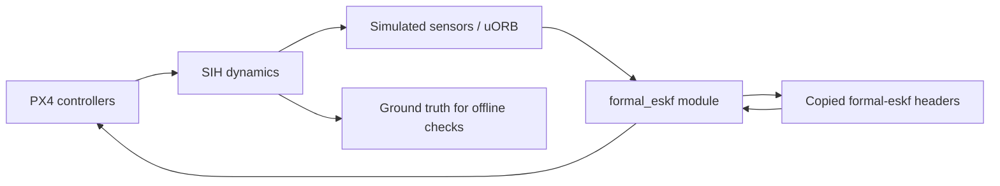

# PX4 SITL integration

This directory owns the PX4 wrapper, board configuration, installation tools and flight tests. The numerical core remains in `include/formal_eskf/`. Installing copies both the wrapper and core headers into PX4; the PX4 build does not reference the original formal-eskf checkout.

The supported target is **PX4 v1.16.2**, commit `54f0455ffcd755534539a7cf33a09a20bf71d29d`, on Linux with GCC 11 or newer and C++20. The dedicated `px4_sitl_formal_eskf` board replaces EKF2 with a single-instance formal-eskf INS using the PX4 matrix backend and double precision.

## Source ownership

| Source in formal-eskf | Installed location in PX4 | Purpose |
| --- | --- | --- |
| `integrations/px4/module/` | `src/modules/formal_eskf/` | uORB adapter, module build, Kconfig and parameter |
| `include/formal_eskf/` | `src/modules/formal_eskf/core/include/formal_eskf/` | Current portable core and runtime headers |
| `LICENSE` | `src/modules/formal_eskf/core/LICENSE` | Core and adapter license |
| `integrations/px4/formal_eskf.px4board` | `boards/px4/sitl/formal_eskf.px4board` | SIH build with EKF2 disabled |
| `integrations/px4/px4-v1.16.2.patch` | Three existing PX4 files | Startup selection, odometry logging and SIH link dependency |

Edit the source in formal-eskf, run the installer again, and rebuild PX4. Changes in formal-eskf do not automatically change an already installed package. PX4 receives regular copied files, with no symlinks, submodule or `FORMAL_ESKF_ROOT` dependency.

## Setup and build

Run these commands from the formal-eskf repository root. `PX4_ROOT` can be anywhere writable; the sibling path below is only an example.

```bash
PX4_ROOT="$(pwd)/../PX4-Autopilot"
./integrations/px4/setup.sh "$PX4_ROOT"
make -C "$PX4_ROOT" px4_sitl_formal_eskf -j8
```

`setup.sh` clones the pinned revision if the target does not exist, initializes only the required MAVLink, events and compression submodules, and installs the package. An existing PX4 checkout must match the pinned commit. It preserves unrelated edits and stops on conflicting files.

Build dependencies include GCC/G++, CMake, Ninja, Python and PX4's `Tools/setup/requirements.txt` (including `empy<4`). Eigen3 is required for the native test oracle. Install the flight test dependencies with:

```bash
python3 -m pip install -r integrations/px4/requirements.txt
```

For an existing PX4 checkout with dependencies already initialized, installation is offline:

```bash
python3 integrations/px4/install.py --px4 "$PX4_ROOT"
make -C "$PX4_ROOT" px4_sitl_formal_eskf -j8
python3 integrations/px4/install.py --px4 "$PX4_ROOT" --check
```

The installer records source revision, source dirty state, and SHA256 hashes in `src/modules/formal_eskf/package-manifest.json`. `--check` checks the copied files and host patch; it does not establish that the binary has been rebuilt. Each flight records the installed manifest and the tested binary's SHA256.

Installation is repeatable. Previously installed files can be updated only if their contents match the previous manifest or the new package. Conflicting local changes and unknown files in the module cause an error before installation. Reconcile or move those files before retrying. A pre-package POC module has no ownership manifest and must be moved aside before its modified files can be replaced.

## Export a package to another machine

```bash
python3 integrations/px4/install.py --export build/px4-package
```

The new directory contains `overlay/`, `manifest.json`, the small PX4 patch and a standalone `install.py`. Copy that directory to the destination machine, then run:

```bash
python3 /path/to/px4-package/install.py --px4 /path/to/PX4-Autopilot
make -C /path/to/PX4-Autopilot px4_sitl_formal_eskf -j8
```

The destination requires the pinned PX4 checkout and its build dependencies. It does not need the formal-eskf source repository. Exports require a new directory to avoid overwriting an earlier package. The manifest detects accidental changes to exported payload files and the host patch.

## Automatic flight

Run from the formal-eskf repository root in a system terminal:

```bash
PX4_ROOT="$(pwd)/../PX4-Autopilot"
RUN_DIR="build/sitl-$(date +%Y%m%d-%H%M%S)"
python3 integrations/px4/sitl_flight.py \
  --px4 "$PX4_ROOT" --output "$RUN_DIR" --check-faults
MPLCONFIGDIR=/tmp/formal-eskf-mpl \
  python3 integrations/px4/analyze_flight.py "$RUN_DIR"
xdg-open "$RUN_DIR/flight.png"
```

The test starts PX4 SIH, uses normal arming, takes off to 5 m, hovers, flies an 8 x 8 m square with a 45-degree heading change, returns, lands and waits for automatic disarming. It then checks invalid GNSS, GNSS timeout and magnetometer timeout, including the 7 s horizontal grace/stop interval and reset counters on recovery. Magnetic checks distinguish outages with and without horizontal aiding, and verify alignment, fusion flags and heading reset notifications across three uORB topics. Omit `--check-faults` for flight only. Each run needs a fresh output directory and takes a few minutes. Instance 1 uses localhost UDP 14541; `--instance` selects another instance from 1 through 9.

The script sends MAVLink commands without the force-arm flag. `COM_RC_IN_MODE=4` configures operation without manual stick input; estimator and sensor arming checks remain enabled. Sensor failure checks run after landing and wait for simulation time to advance, with a bounded wall-clock timeout. The script shuts down the PX4 instance it started.

On a host running other builds or verification tools, PX4 boot can exceed the default 60-second startup deadline. Use `--startup-timeout 180` to allow longer startup; the selected deadline is recorded in `provenance.json`. Flight tracking, estimator validity and offline acceptance thresholds remain the same.

Artifacts include `flight.json`, `faults.json`, `provenance.json`, `px4.log` and the original ULog under `rootfs/log/`. The independent analyzer produces `analysis.json` and `flight.png`, comparing estimates against SIH ground truth. It checks finite states and published covariance diagonals, tracking, attitude error, estimate validity, failsafes, automatic landing/disarming and logging dropouts. Both commands must succeed for full acceptance.

## Interactive flight

```bash
PX4_PARAM_FESKF_EN=1 \
PX4_PARAM_SENS_IMU_MODE=1 \
PX4_PARAM_COM_RC_IN_MODE=4 \
make -C "$PX4_ROOT" px4_sitl_formal_eskf sihsim_quadx
```

Wait for `Ready for takeoff!`, then enter these commands at the `pxh>` prompt:

```text
formal_eskf status
param set MIS_TAKEOFF_ALT 5
commander takeoff
listener vehicle_local_position
listener vehicle_attitude
simulator_sih status
```

When ready to land, enter `commander land`. Wait for `Disarmed by landing` before entering `shutdown`.

## Where the dynamics run

SIH's forces, torques and equations of motion are compiled into the same `build/px4_sitl_formal_eskf/bin/px4` executable. `simulator_sih`, simulated sensors, the estimator and controllers run as tasks in that process and communicate through uORB. The test uses a 4 ms dynamics step (250 Hz) and lockstep simulation time. SIH has no built-in 3D window; the analyzer supplies the flight plot.

The external Python script supplies MAVLink commands and checks results. The dynamics execute inside PX4.



## Adapter behavior and verification boundary

- Uses integrated IMU instance 0 in FRD coordinates and `timestamp_sample`. A single work-queue writer owns the filter, with mutex-serialized shell diagnostics.
- Initializes tilt and gyro bias from stationary IMU samples; magnetometer and the selected geographic/stored/zero declination initialize yaw. No EKF2 or ground-truth subscriptions enter the estimator.
- Qualifies GNSS with the portable quality monitor before startup and fusion. Uses independent velocity, horizontal-position and height gates. Future samples wait; stale/invalid samples cannot refresh health. Velocity and horizontal position have the portable lifecycle and checked resets; each successful reset publishes its deltas/counters. GNSS/barometer height arbitration and magnetic measurements use separate adapter helpers.
- Connects magnetic field checks, heading consistency, lifecycle, gated correction and real heading/covariance resets through direct operations in `module/FormalEskfAttitude.cpp`. The module owns magnetic history, estimator alignment and reset reporting; `module/DeploymentProfile.hpp` owns the fixed settings. These match the pinned PX4 v1.16.2 defaults for noise (5 microtesla), gate (3 sigma), strength tolerance (20 microtesla), health (>1 s), no-data stop (1 s) and unsuccessful-fusion timeout (>7 s), without live EKF2 parameter bindings.
- Publishes NED position/velocity, scalar-first body-to-NED quaternions, covariance diagonals, biases and estimator status. Horizontal aiding uses actual fusion/reset progress: report dead reckoning after 1 s, withdraw horizontal validity after 5 s, and stop GNSS sessions after 7 s of missing data or sustained poor quality. Height source activity and validity follow the policy below; magnetic progress retains its existing freshness check.
- Holds the previous IMU rate for small missing intervals; discontinuities beyond 50 ms and IMU identity/calibration changes latch a fault. Numerical failures also latch a fault. Restart is required for recovery.
- Reserves a 60 KiB work-queue stack. The module disables fast-math, FMA contraction, exceptions and RTTI. Lockstep virtual-time performance counters do not measure wall-clock CPU cost.

This is a single-sensor SITL POC with stationary startup and simulated sensor noise. It has no receiver-delay compensation, output predictor, redundant sensors, or wind, terrain and magnetic-bias states. Magnetic fusion retains a three-component observation with `ESKF_MAG_TILT=1`; it reports heading aiding, not 3D magnetic-state estimation. AUTO/3D switching and terrain-based in-flight realignment remain unconnected. See [the magnetic integration contract](../../docs/spec/verification-requirements.md#px4-module-magnetic-aiding). Heading variance approximates yaw variance with the local attitude-error z component for the tested low-tilt flight. Sensor failure checks cover flag withdrawal and recovery on the ground, not continued flight through sensor failures.

### Geographic magnetic reference

The module queries PX4's host WMM at startup and then at intervals greater than
10 s while its own horizontal position is valid. It expresses each model in the
fixed origin NED and adopts changes greater than 1 degree or 1 microtesla.
Unavailable lookups retain the last valid model; without one, strength checks
use the broad fallback range. `formal_eskf status` reports lookup count, model
and heading revisions, selected source and unavailable attempts.

| Startup parameter | Default | Meaning |
| --- | --- | --- |
| `FESKF_DECL_TYPE` | 3 | Bit 0: geographic heading when available; bit 1: permit stored declination fallback |
| `FESKF_MAG_DECL` | 0° | Stored east-positive declination, -180° to 180° |

Mask 0 selects magnetic north; 1 selects geographic or zero; 2 selects stored
or zero; 3 selects geographic, then stored, then zero. Restart the module after
changing settings. WMM still supplies independent health checks when geographic
heading is disabled; its updates cannot rewrite the seed-based heading reference
in that mode. Parameters use `FESKF_` because this board excludes EKF2.
There is no learned-field branch or automatic declination saving.
See [the reference contract](../../docs/spec/verification-requirements.md#px4-module-geographic-magnetic-reference).

### Height aiding

`HeightAiding` manages GNSS and barometer together, with GNSS as preferred height
reference. Each source has a separate altitude-offset estimate outside the INS;
the reference's offset is frozen and the secondary offset can learn relative drift.
The main correction uses the prior offset and includes its variance.

| Fixed deployment setting | Value |
| --- | --- |
| Barometer noise / height gates | 3.5 m standard deviation / 5 sigma |
| GNSS height noise | `max(epv, 0.75 m)`, capped at 10 m while barometer is active |
| Barometer warmup / reset LPF | More than 20 samples / alpha 0.1 |
| Missing-data stop | Barometer 400 ms; GNSS 1 s |
| Unsuccessful fusion timeout | Strictly more than 5 s |

A stopped reference falls back to the remaining active source without resetting
navigation. Qualified GNSS re-entry reclaims the reference with a real height
reset; barometer re-entry aligns its offset. Persistent rejection stops the bad
source while another works. Only a fresh reference measurement can reset height
when shared height progress times out or the independent acceleration criterion
below requests recovery. A barometer fault caused by persistent
rejection requires source/calibration change or module restart to clear.

Height resets transport the sensor offsets and publish matching local/global/status
reset counters and deltas. Down-velocity resets have their own counter; they do not
increment horizontal-velocity reset counters. Source sessions, successful fusion,
reset progress and the 5 s height-validity window are separate.

The reference policy is checked against the pinned [height controller](https://github.com/PX4/PX4-Autopilot/blob/54f0455ffcd755534539a7cf33a09a20bf71d29d/src/modules/ekf2/EKF/height_control.cpp),
[GNSS height controller](https://github.com/PX4/PX4-Autopilot/blob/54f0455ffcd755534539a7cf33a09a20bf71d29d/src/modules/ekf2/EKF/aid_sources/gnss/gnss_height_control.cpp)
and [barometer controller](https://github.com/PX4/PX4-Autopilot/blob/54f0455ffcd755534539a7cf33a09a20bf71d29d/src/modules/ekf2/EKF/aid_sources/barometer/baro_height_control.cpp), using public parameter defaults.
It retains immediate sample-time fusion and a fixed GNSS preference; dynamic-pressure
and ground-effect corrections and delayed fusion are separate work. See [the height contract](../../docs/spec/verification-requirements.md#r-height-fusion-px4-gnssbarometer-height-management).

The existing vertical-acceleration recovery policy is now connected. A held IMU
fault can permit a bounded Down innovation from qualified GNSS velocity or either
height source; velocity additionally requires passing horizontal innovations and
receiver speed accuracy strictly below its limit. Raw gate ratios remain visible;
health uses the selected residual. This never bypasses source quality/lifecycle.

The independent reset criterion uses last-good acceleration, not the held fault:
known health with no good sample or strictly more than 500 ms since the last good
sample can request recovery even after successful bounded fusion. Velocity uses
preceding health; height uses the current pre-height evaluation. Only fresh,
qualified observations authorize real resets, with the existing counter/delta
notifications. The separate 5 s shared-height timeout remains in force.

### IMU health and bias learning

The module and replay share `runtime::ImuBiasInhibition`. Before prediction, it
checks bias-corrected decaying peaks with fixed 25 m/s² / 3 rad/s limits and a
0.5 s decay constant. Accel and gyro use their own integration durations. High
dynamics or the preceding vertical-acceleration fault freezes accel-bias updates;
gyro learning remains enabled. All current GNSS, height and magnetic corrections
receive the same permissions and retain their ordinary state corrections.

Vertical health uses current GNSS velocity and preceding height innovations from
active sources, after GNSS velocity and before height fusion. Rejected measurements
remain evidence; pre-reset innovations do not. The detector's three-second fault
hold feeds the next IMU tick's bias policy. Module status prints the permission
masks, high-dynamics result and health availability. No fake-aiding modes are
inferred from loss of GNSS.

After initialization the module continues prediction with accelerometer-clipped
samples. Before prediction, the production `ImuPrediction.hpp` path selects
`4.9^2 m²/s⁴` sampled accel variance per clipped body axis, or on all axes when
the preceding vertical-health verdict is bad. It starts from configured noise
each time, preserving gyro variance. It then selects each bias driving intensity
using the prior bias variance and selected IMU variance: equality or a larger
bias variance suppresses that axis's increment. Gap holds apply this bias-noise
rule with configured IMU variance. Intensities retain `intensity * dt` scaling
and can resume after a later covariance reduction. Current
clipping also inhibits the corresponding accel-bias learning and reaches the
health detector after GNSS velocity, before height fusion.

Startup clipping, gyro clipping and undefined clipping bits remain rejected.
Rejected/missing IMU data resets health continuity; synthetic gap holds retain
configured noise without inventing clipping metadata. This is the pinned PX4
noise-selection rule, not reconstruction of lost acceleration or complete EKF2
timing equivalence. See
[the noise contract](../../docs/spec/verification-requirements.md#r-imu-process-noise-fault-dependent-sampled-imu-variance)
and [the health/bias contract](../../docs/spec/verification-requirements.md#r-px4-imu-bias-module-health-and-bias-learning-inhibition).

Gravity aiding uses the shared replay sampler and tilt-alignment test. The module
owns alignment independently of gravity enablement and sampling history, and
directly sequences the gravity phase in `FormalEskfAttitude.cpp`.
Actual IMU increments form rotation-aware, non-overlapping observations near
10 ms; the last emitted duration is printed in module status. Prediction holds
are excluded and discontinuities clear sampler/LPF history. The module supplies
actual GNSS lifecycle activity, fresh land-detector rest information and
interval clipping. An aligned, unaided filter may correct when gravity-band or
rest conditions permit; clipping still blocks correction. Successful corrections
apply the same bias limits as the other measurement groups.

`FESKF_GRAV_EN=1` enables this path by default; read at startup, with 0 available
for A/B checks. The model and g² I observation weight are unchanged from replay.
PX4 v1.16.2 supplies the eligibility/downsampling reference; its normalized,
sequential, innovation-gated correction is not reproduced. Gravity innovation
gating remains deferred. `cs_gravity_vector` reports mode activity; the printed
fusion count increases only after an actual successful correction.

The wrapper is outside the portable numerical core and its existing Lean/ESBMC claims. Magnetic, height and IMU/bias integration are linked in the requirement/traceability map with its formal evidence still pending; no proof of PX4, concurrency, total stack use or hardware flight is asserted. Native tests and closed-loop SITL are separate empirical evidence.

The host patch selects the estimator at boot, starts the lockstep logger from IMU updates during alignment, logs odometry variances and adds SIH's direct `lat_lon_alt` dependency. The reduced board can print missing optional DDS, GPS-driver, camera and VTOL command/parameter messages from the shared startup script.

## GNSS integration scope

Behavior is checked against the pinned
[GNSS checks](https://github.com/PX4/PX4-Autopilot/blob/54f0455ffcd755534539a7cf33a09a20bf71d29d/src/modules/ekf2/EKF/aid_sources/gnss/gps_checks.cpp)
and [fusion controller](https://github.com/PX4/PX4-Autopilot/blob/54f0455ffcd755534539a7cf33a09a20bf71d29d/src/modules/ekf2/EKF/aid_sources/gnss/gps_control.cpp).
The adapter uses their fixed default quality/noise/gate settings; live EKF2
parameter changes do not configure this module. Quality recovery, reset feedback
and message conventions are specified in
[PX4 GNSS integration](../../docs/spec/verification-requirements.md#px4-gnss-integration).

The single-source GNSS height lifecycle remains disabled; `HeightAiding` now
coordinates the GNSS/barometer height sources. Emergency yaw, receiver selection,
lever arms and delayed fusion remain separate work.
GNSS sample-time handling is still immediate and differs from EKF2's buffered
publication-time path. This is not complete EKF2 parity.

## Developer checks

```bash
./scripts/format_cpp.sh --check
python3 integrations/px4/test_package.py --px4 "$PX4_ROOT"
./integrations/px4/test_core.sh "$PX4_ROOT"
```

Package checks exercise a clean pinned PX4 fixture, standalone export/install, repeat installation, update handling, conflict preservation, revision rejection and exclusion of editor scratch files. Core checks use the existing native suite with the PX4 matrix backend. Run the flight and analyzer above after rebuilding to validate the complete control loop.

To test the module's actual initialization and update paths after installing:

```bash
cmake -S "$PX4_ROOT" -B "$PX4_ROOT/build/px4_sitl_formal_eskf" \
    -DFORMAL_ESKF_MODULE_TESTS=ON
cmake --build "$PX4_ROOT/build/px4_sitl_formal_eskf" \
    --target formal_eskf_module_test --parallel 2
ctest --test-dir "$PX4_ROOT/build/px4_sitl_formal_eskf/src/modules/formal_eskf" \
    --output-on-failure
```

The tests execute production `Run()` with real PX4 messages and uORB. They
control the clock and timer dispatch, covering startup settings, accumulation,
IMU admission, gap boundaries, separate integration periods, source/calibration
changes, failure latching and watchdog output. The work-queue manager is not
started; its unavailable-queue messages and deliberately injected fault messages
are expected. These tests do not establish scheduler or concurrent-access
correctness. The executable optionally takes a trace filename to record state,
covariance and the seven topic payloads for deterministic before/after comparison.
The test target is opt-in and is not linked into the flight binary.

## Validation evidence

[Dated validation records](validation-history.md) retain the native, sanitizer,
package and SITL results, including unsuccessful runs and their limitations.
They describe the recorded source/binary baselines, not a fresh check of the
current checkout. Local `output/` paths are repository-root-relative and may
not be present in a new clone; summaries alone are not replacement evidence.

Use the installed package manifest, binary hash and per-run reports to identify
what was tested. Requirement mappings remain in the
[traceability map](../../formal/agent-review/traceability-map.json), and formal
acceptance follows the [review criteria](../../docs/spec/formal-verification-traceability-and-review-criteria.md).
